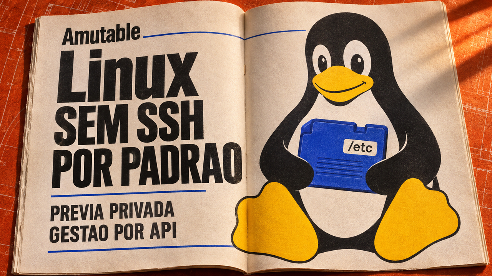

Administrar servidores por API, economizar memória ao executar modelos e corrigir o login de uma VPN: os destaques de hoje tratam de decisões práticas de infraestrutura. A Amutable explica seu Linux sem SSH por padrão, um estudo mede o efeito da quantização do cache do Qwen e a SonicWall corrige uma falha que permite contornar controles SAML com outras credenciais válidas.

## Amutable detalha administração de servidores por APIs e imagens de configuração

Em **6 de novembro**, a Amutable detalhou o **Amutable Foundations**, ainda em prévia privada. Seu sistema operacional usa pacotes do Fedora para montar imagens prontas antes da implantação. Por padrão, os servidores ficam sem shell Unix, acesso por SSH e interpretadores como Python e Perl.

A configuração também chega como imagem: um conjunto assinado e criptografado de arquivos é aplicado de forma **atômica**, aparecendo inteiro ou permanecendo ausente. Isso evita a instalação parcial da configuração e busca reduzir diferenças acumuladas entre máquinas que deveriam executar o mesmo ambiente.

Quem coordena os servidores é o **plano de controle**, serviço que recebe relatórios de estado e prepara novas imagens de configuração. Tarefas como consultar logs, gerenciar serviços e reiniciar máquinas passam por interfaces **Varlink**, disponíveis por HTTPS quando o acesso remoto é habilitado. Diagnóstico e recuperação precisam, portanto, ser preparados para esse modo de administração.

Com hardware compatível, a liberação da configuração pode depender de uma verificação local do estado da máquina. O projeto usa recursos como o **TPM**, que protege chaves e participa dessa verificação; também admite assinaturas apenas por software, com garantias diferentes. A arquitetura prevê inicialização sem contato com o plano de controle usando o TPM local e inclui restauração ao estado de fábrica. São mecanismos descritos pela equipe para a prévia privada.

Fonte: [visão técnica do Amutable Foundations](https://amutable.com/blog/amutable-foundations-technical-overview).

## Teste do Qwen3.8-27B reduz cache de 4 para 2,13 GiB com oito bits

Erlidev publicou em **6 de novembro** uma comparação de **35 versões quantizadas do Qwen3.8-27B** em llama.cpp, ExLlamaV3 e vLLM, ferramentas usadas para executar modelos. **Quantizar** significa representar valores com menos bits para economizar memória. O estudo avalia tanto os pesos do modelo quanto o **cache KV**, que guarda resultados intermediários usados ao processar o contexto e produzir novos tokens.

Para um contexto de aproximadamente **64 mil tokens**, a tabela aponta **4 GiB** de cache em 16 bits. No llama.cpp e no ExLlamaV3, as opções de oito bits reduzem essa parcela para **2,13 GiB**, com alteração praticamente nula na métrica numérica usada pelo autor. A economia é do cache; os pesos do modelo e outros buffers continuam ocupando memória.

O teste estima a **divergência KL**, uma medida da diferença entre as probabilidades do próximo token e as de uma referência sem quantização. Ao comparar precisões de cache, mantém os pesos e os tokens avaliados iguais. Isso ajuda a isolar a alteração numérica; verificar se um agente continua corrigindo programas ou completando tarefas exige testar essas entregas separadamente.

Os caches de quatro bits economizaram mais espaço, mas aumentaram a divergência, com penalidade crescente ao longo dos documentos extensos avaliados. A amostra tinha 12 documentos longos e apenas um chegava à faixa de 32 mil a 64 mil tokens. No vLLM, o cache de oito bits também introduziu uma pequena divergência adicional. Para experimentar no próprio hardware, compare memória, tempo de resposta e correção dos resultados mantendo modelo e tarefas constantes.

Fonte: [metodologia, tabelas e limites do estudo de Erlidev](https://erli.xyz/posts/qwen38-27b-quant-kv-comparison/).

## Falha explorada no SonicOS permite contornar controles SAML com credenciais alternativas

A **CVE-2026-19868** entrou em **6 de novembro** no catálogo de vulnerabilidades exploradas da CISA, agência americana de cibersegurança. Ela afeta o serviço de VPN SSL do **SonicOS**, sistema dos firewalls SonicWall, **quando o login por SAML está habilitado**.

Segundo o registro publicado pela fabricante, alguém com **credenciais válidas para outro método de autenticação** pode contornar os controles de SAML, mecanismo usado para integrar o login a um provedor de identidade. Isso pode alcançar também a autenticação de múltiplos fatores exigida por esse caminho SAML.

O registro da SonicWall lista equipamentos **Gen7 e Gen8**, nas linhas afetadas até **7.3.3-7015** e **8.2.2-8015**, respectivamente. As correções estão em **7.3.4-7013 para Gen7** e **8.2.3-8015 para Gen8**, ou versões posteriores. Confira seu modelo na tabela do fornecedor e atualize; o boletim não oferece uma solução temporária. A CISA classifica a falha como explorada e registra como desconhecido seu uso em campanhas de ransomware.

Fontes: [boletim da SonicWall e versões corrigidas](https://psirt.global.sonicwall.com/vuln-detail/SNWLID-2026-0014), [registro CVE publicado pela SonicWall](https://cveawg.mitre.org/api/cve/CVE-2026-19868) e [catálogo KEV da CISA](https://www.cisa.gov/sites/default/files/feeds/known_exploited_vulnerabilities.json).

## Destaques rápidos para hoje.

- **oo7 0.7.0 adiciona integração de credenciais com o Git.** A versão de **5 de novembro**, destacada pelo GNOME no balanço do dia 7, inclui o `git-credential-oo7`, que permite guardar credenciais do Git no serviço de armazenamento de segredos oo7. A ferramenta de terminal também ganha saída JSON para automações. A equipe anuncia o `oo7-daemon`, implementação em Rust do Secret Service, como estável; a adoção deve seguir o empacotamento e a configuração da distribuição. Fontes: [notas da versão](https://github.com/linux-credentials/oo7/releases/tag/0.7.0) e [balanço do GNOME](https://thisweek.gnome.org/posts/2026/11/twig-273/).

- **Firefox busca páginas do Datasette antes de o visitante avançar, relata Simon Willison.** No relato de **7 de novembro**, o criador da ferramenta para explorar dados percebeu que o cabeçalho HTTP `Link` com `rel="next"` provocava uma busca automática pela próxima página da tabela. Isso fazia o servidor renderizar dados mesmo quando o visitante não avançava. O relato abre uma discussão de correção no Datasette e oferece uma verificação útil para aplicações paginadas: observar no painel de rede o que o navegador busca antes de qualquer clique. Fonte: [relato de Willison](https://simonwillison.net/2026/Nov/7/link-rel-next/).

- **Coldframe ajusta certificados de sua isca para ataques a controladores de refrigeração.** O projeto é um *honeypot*: um sistema-isca com telas e comandos falsos, feito em Python com a biblioteca padrão. Ele registra tentativas de login e ações sobre equipamentos simulados, descartando comandos de exploração em vez de executá-los. Uma atualização de **7 de novembro, no horário de Brasília**, alterou as datas dos certificados de teste para evitar que denunciem a criação recente da isca. A documentação recomenda isolamento, restrição de saída de rede e cuidado com os logs, cujo conteúdo vem de visitantes não confiáveis. Fontes: [projeto e limites](https://github.com/hedgerow-dev/coldframe) e [alteração dos certificados](https://github.com/hedgerow-dev/coldframe/commit/d3f4363a56220c20ccfaa28024f0018c2a78036c).

- **Indic Turn Detector usa a transcrição para estimar quando a pessoa terminou de falar.** O modelo **v1.0, de 7 de novembro**, recebe texto e contexto recente da conversa para complementar a detecção de atividade de voz. Suporta inglês, Hinglish e sete idiomas indianos; português não está na lista. O autor calibrou dois perfis com limites de 5% e 10% de cortes falsos na amostra de validação usada. Esses valores são critérios daquele teste, e a escolha do perfil precisa ser validada nas conversas reais da aplicação. Fonte: [ficha do modelo, idiomas e avaliação](https://huggingface.co/tarun7r/indic-turn-detector).

- **Experimento com a porta zero mostra a diferença entre uma API de rede e o pacote transmitido.** Em texto de **6 de novembro**, acidvegas explica que informar a porta zero à operação `bind`, que associa um socket a um endereço local, pede ao sistema operacional uma porta disponível. Já um pacote TCP pode trazer zero no campo de destino. O autor demonstra um redirecionamento desse tráfego para um serviço em uma porta comum. A distinção ajuda a revisar filtros e ferramentas: o significado especial de um valor na API da aplicação não determina sozinho o tratamento do pacote na rede. Fonte: [explicação e experimento do autor](https://acid.vegas/blog/the-port-that-does-not-exist/).

- **Neil Brown relata como simplificou a infraestrutura livre de seu escritório.** No balanço de **6 de novembro**, o advogado conta que trocou o Nextcloud por Syncthing para arquivos e Radicale para calendários e contatos, após dificuldades com a solução anterior. Também desligou serviços pouco usados, como Jitsi e CryptPad. O relato mostra escolhas de manutenção de um escritório pequeno, com Debian no desktop e ferramentas hospedadas pelo próprio responsável: antes de adicionar mais um serviço, vale considerar o uso real e o trabalho necessário para mantê-lo. Fonte: [experiência de Brown com software livre](https://decoded.legal/blog/2026/11/running-a-law-firm-on-free-software-2026-edition/).

> Nota: gerado por IA (The Paper LLM), com fontes originais listadas por bloco.

<!--
briefing_id: 31079
source_urls:
  - https://amutable.com/blog/amutable-foundations-technical-overview
  - https://erli.xyz/posts/qwen38-27b-quant-kv-comparison/
  - https://psirt.global.sonicwall.com/vuln-detail/SNWLID-2026-0014
  - https://cveawg.mitre.org/api/cve/CVE-2026-19868
  - https://www.cisa.gov/sites/default/files/feeds/known_exploited_vulnerabilities.json
  - https://github.com/linux-credentials/oo7/releases/tag/0.7.0
  - https://thisweek.gnome.org/posts/2026/11/twig-273/
  - https://simonwillison.net/2026/Nov/7/link-rel-next/
  - https://github.com/hedgerow-dev/coldframe
  - https://github.com/hedgerow-dev/coldframe/commit/d3f4363a56220c20ccfaa28024f0018c2a78036c
  - https://huggingface.co/tarun7r/indic-turn-detector
  - https://acid.vegas/blog/the-port-that-does-not-exist/
  - https://decoded.legal/blog/2026/11/running-a-law-firm-on-free-software-2026-edition/
-->
