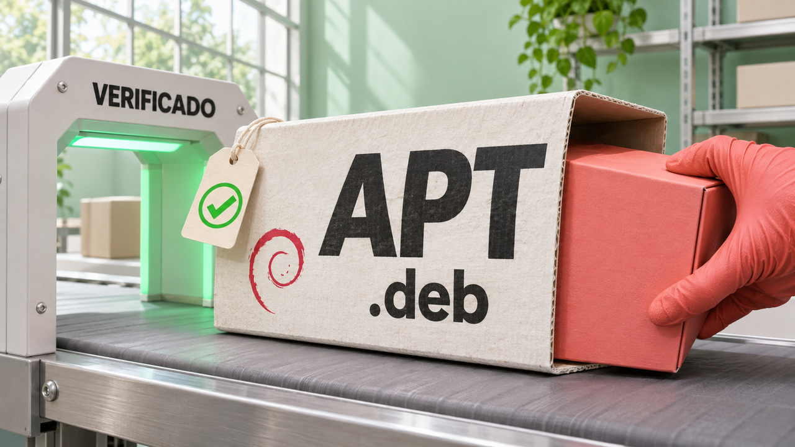

A atualização do APT exige atenção de quem mantém Debian e Ubuntu: uma falha permite trocar um pacote depois da conferência de integridade. No desenvolvimento, o Go estabiliza uma API de JSON com novos padrões de compatibilidade, e o Workflow SDK elimina uma corrida que podia iniciar a mesma tarefa duas vezes. Pesquisas sobre agentes e novidades de ferramentas completam a edição.

## APT corrige falha que permite substituir um pacote depois da verificação

O Debian publicou em **4 de novembro** uma correção para a **CVE-2026-109518**, vulnerabilidade no APT, gerenciador usado para baixar e instalar pacotes. Um atacante capaz de interferir no tráfego HTTP pode substituir um pacote depois de sua verificação e provocar execução de código como **root**, o administrador do sistema.

O problema aparece quando um redirecionamento faz dois downloads apontarem para o mesmo endereço. O APT pode juntá-los, e o tratamento incorreto do arquivo ao retomar a transferência permite a substituição. Assim, o conteúdo instalado pode ser diferente daquele que passou pela conferência de integridade.

A Canonical esclarece que a exploração exige **repetir um download que falhou**. Essa repetição vem habilitada por padrão desde o Ubuntu 22.04 LTS. Versões anteriores ficam expostas quando `Acquire::Retries` foi configurado com valor diferente de zero.

No **Debian 13, trixie, a correção está no APT 3.0.4**. No Ubuntu, confira a versão corrigida para sua edição na tabela da Canonical. A empresa orienta desabilitar temporariamente as repetições com `Acquire::Retries=0` ao instalar essa atualização. Usar HTTPS protege contra a interferência no tráfego; a correção continua necessária porque um espelho de pacotes malicioso também pode explorar a falha.

Fontes: [Debian — DSA-6607-1](https://lists.debian.org/debian-security-announce/2026/msg00526.html) e [orientações e versões corrigidas no Ubuntu](https://ubuntu.com/blog/apt-vulnerability-fixes-available).

## Go 1.27 estabiliza JSON v2 com novos padrões de leitura e escrita

A equipe do Go anunciou em **4 de novembro** que `encoding/json/v2` e `encoding/json/jsontext` estão estáveis e disponíveis no **Go 1.27**. JSON é o formato de texto usado por muitas APIs para trocar dados. A migração exige atenção tanto ao que a aplicação aceita quanto ao que devolve.

Por padrão, a nova API rejeita nomes duplicados dentro de um objeto e texto com codificação UTF-8 inválida. A correspondência entre nomes JSON e campos de uma estrutura Go passa a distinguir maiúsculas de minúsculas. Na saída, slices e mapas `nil` — valores sem uma coleção inicializada — viram arrays e objetos vazios, respectivamente, em vez de `null`.

Os pacotes dividem o trabalho: `jsontext` processa a sintaxe e permite ler ou escrever partes do documento em fluxo; `json/v2` converte entre JSON e valores Go. **A API antiga continua suportada**, e opções de compatibilidade permitem preservar comportamentos específicos durante a transição. Antes de migrar, teste chaves repetidas, diferenças de caixa, valores nulos e conversões personalizadas.

Fonte: [anúncio e orientações de migração do Go](https://go.dev/blog/jsonv2).

## Workflow SDK 5.4.0 impede inícios duplicados com uma reserva atômica

A Vercel anunciou em **4 de novembro** uma mudança no **Workflow SDK 5.4.0**, biblioteca para coordenar tarefas persistentes. Antes, duas requisições podiam consultar se uma tarefa já existia, ambas receber uma resposta negativa e ambas iniciá-la. Agora, a admissão de uma execução e a reserva de seu token acontecem em uma operação atômica, sem essa janela entre os dois passos.

O token identifica a tarefa e pode usar um dado do negócio, como o número de um pedido. Com `experimental_hook`, uma única execução fica dona dele; uma tentativa duplicada recebe `HookConflictError`, que informa a execução existente. O mesmo mecanismo aceita mensagens antes de o processamento começar, guarda esses dados e os entrega em ordem.

A opção `experimental_minRetention` permite estender a reserva para recusar duplicatas tardias, inclusive depois do encerramento. O prazo é contado **desde o início da execução**. Essa proteção cobre o início do workflow; operações realizadas dentro dele ainda precisam de tratamento próprio para novas tentativas.

Fonte: [changelog da Vercel](https://vercel.com/changelog/atomic-start-hooks-in-the-workflow-sdk).

## OpenAI relata 948 falhas distintas de elevação local de privilégio no Linux

A OpenAI publicou em **4 de novembro** uma pesquisa em que agentes reproduziram **1.724 vulnerabilidades** no kernel Linux e produziram explorações associadas a **948 falhas distintas de elevação local de privilégio**. Nesse tipo de ataque, alguém que já executa código como usuário sem privilégios consegue chegar a root.

Segundo a empresa, a campanha de meados de outubro usou máquinas virtuais de desktop com proteções usuais habilitadas e custou aproximadamente **US$ 1,2 milhão em créditos de API**. A análise agrupou variantes para chegar à contagem de falhas distintas. Os números são resultados relatados pela OpenAI para esse ambiente de pesquisa.

A revisão humana encontrou um problema importante numa rodada inicial: 20 de 200 explorações chegavam a root por uma falha diferente da atribuída ao agente. A equipe acrescentou uma verificação independente do caminho usado. O caso mostra por que obter o resultado esperado precisa vir acompanhado da confirmação de sua causa.

Os patches passam por revisão de especialistas, e parte dos achados já tinha correções ou discussões públicas ao término da análise. Para quem administra Linux, a consequência prática é acompanhar as atualizações da distribuição: a contagem da pesquisa inclui situações de correção diferentes.

Fonte: [pesquisa da OpenAI, metodologia e limitações](https://openai.com/index/a-thousand-fewer-paths-to-root/).

## CASE-Bench mede se agentes consultam as proteções relevantes do projeto

Um preprint, estudo ainda preliminar, publicado em **4 de novembro** apresenta o **CASE-Bench**: 145 tarefas derivadas de vulnerabilidades reais em 51 projetos. Os agentes recebiam pedidos para reconstruir trechos de código, sem aviso de que a tarefa envolvia segurança. A avaliação verificava o funcionamento da solução e sua resistência ao ataque usado em cada teste.

Nas trajetórias analisadas, o código que continha a proteção relevante apareceu no contexto observado em apenas **27% a 36%** dos casos. O resultado aponta uma dificuldade concreta: as regras de segurança existentes no repositório precisam chegar ao contexto do agente para orientar a implementação.

Os percentuais se limitam à amostra estudada. Além disso, resistir ao ataque escolhido para um teste deixa outras possíveis falhas fora dessa verificação. Para quem configura agentes, uma aplicação prática é incluir as regras de segurança do projeto na busca de contexto e testá-las separadamente dos requisitos funcionais.

Fonte: [A.S.E 2.0 — metodologia e resultados do CASE-Bench](https://arxiv.org/html/2611.06294v1).

## Destaques rápidos para hoje.

- **VS Code 1.145 adiciona agendamento às automações locais de agentes.** A versão estável de **4 de novembro** aceita expressões cron de cinco campos para definir quando executar tarefas. O recurso se limita às automações locais. Também entram, em prévia, navegação e painéis interativos pelo host remoto do agente, permitindo abrir no editor a aplicação executada em outra máquina. Fonte: [notas do VS Code 1.145](https://code.visualstudio.com/updates/v1_145).

- **GitHub Copilot chega ao assistente integrado do Xcode em prévia pública.** O anúncio de **4 de novembro** exige **Xcode 27.3 beta e macOS Tahoe 26.6 ou posterior** e aceita todos os planos do Copilot. A configuração fica em Settings, na seção Intelligence. A extensão Copilot for Xcode continua disponível separadamente. Fonte: [changelog do GitHub](https://github.blog/changelog/2026-11-04-github-copilot-is-now-available-in-xcodes-coding-assistant/).

- **A Kernel relata exposição de credenciais na infraestrutura de navegadores.** No comunicado de **4 de novembro**, a empresa informa que credenciais comprometidas deram acesso a logs com algumas chaves de API e segredos de aplicações. Em **3 de novembro**, o invasor também acessou quatro servidores com GPU, três usados para sessões de navegador. A Kernel afirma ter revogado credenciais, retirado os servidores afetados do ar e avisado os clientes atingidos. Quem recebeu a notificação deve revisar também os segredos de terceiros indicados nela. Fonte: [comunicado da Kernel](https://dev.kernel.sh/blog/public-notice-of-security-incident-nov-4-2026).

- **Xen alerta para acesso à memória de outras máquinas virtuais.** O aviso **XSA-523**, de **3 de novembro**, descreve duas falhas nas operações de cópia de memória compartilhada. Um convidado malicioso pode ler e escrever na memória de outros domínios, incluindo o **Dom0**, responsável pelo gerenciamento. O projeto informa que versões desde 4.6 são vulneráveis, disponibiliza patches e diz não conhecer mitigação temporária. Confira a atualização do hipervisor com seu fornecedor. Fonte: [boletim do Xen](https://xenbits.xen.org/xsa/advisory-523.html).

- **A CISA inclui uma falha da Apple no catálogo de vulnerabilidades exploradas.** A entrada de **4 de novembro** é a **CVE-2024-27834**. Segundo a Apple, ela permite contornar a autenticação de ponteiros quando o atacante já dispõe de leitura e escrita arbitrárias em memória. A correção chegou ao Safari 17.5 em maio de 2024; a novidade é a inclusão no catálogo. Verifique se os dispositivos usam versões suportadas e atualizadas. Fontes: [catálogo KEV da CISA](https://www.cisa.gov/sites/default/files/feeds/known_exploited_vulnerabilities.json) e [aviso histórico da Apple](https://support.apple.com/en-us/120896).

- **LXQt 2.5.0 remove a última dependência do LXDE e exige Qt 6.10.** Lançado em **5 de novembro**, o ambiente gráfico substitui `menu-cache` por uma implementação própria e amplia recursos do QTerminal. Há um alerta para usuários de X11: a retirada desse suporte do `libkscreen` 6.8 quebrou as configurações de monitor do LXQt. Uma versão corretiva está planejada. Confira essa combinação na distribuição antes de atualizar. Fonte: [anúncio do LXQt](https://lxqt-project.org/release/2026/11/05/release-lxqt-2-5-0/).

- **LZ4 1.11.0 leva compressão paralela para a biblioteca.** A versão de **4 de novembro** permite configurar trabalhadores paralelos pela interface `lz4frame`; antes, esse recurso estava disponível no programa de linha de comando. O campo `nbWorkers` ainda é experimental, e a biblioteca estática continua usando uma única thread por padrão. A ferramenta de terminal também ganha `--memory` para limitar o orçamento de memória. Fonte: [release do LZ4](https://github.com/lz4/lz4/releases/tag/v1.11.0).

- **Chris Wellons propõe agrupar a saída do terminal por tempo.** No texto de **5 de novembro**, ele mostra como imprimir nomes de arquivos pode dominar uma extração: descarregar o buffer a cada linha provoca muitas escritas pequenas. Sua alternativa, usada no `tugz`, acumula texto e verifica um prazo entre trechos de trabalho, com cerca de 100 milissegundos como referência. A liberação da saída depende de o programa executar essa verificação; o prazo sozinho não aciona um temporizador. Fonte: [análise e implementação de Wellons](https://nullprogram.com/blog/2026/11/05/).

- **Uma única CPU pode serializar `Parallel.ForEachAsync` no .NET.** Em um laboratório publicado em **4 de novembro**, Guilherme Appel mediu o efeito do limite padrão de concorrência baseado em `Environment.ProcessorCount`. Isso pode deixar capacidade ociosa quando cada operação espera respostas de APIs. O autor propõe limites separados por dependência para aproveitar essa espera sem sobrecarregar os serviços chamados. Os resultados vêm de serviços simulados. Fonte: [experimento no Stack Overflow](https://stackoverflow.blog/2026/11/04/your-net-parallel-loop-can-become-serial-in-a-one-cpu-container/).

- **O compilador Rust reduz buscas auxiliares ao armazenar posições do código.** No balanço de **4 de novembro**, Nicholas Nethercote descreve uma representação mais compacta dos *spans*, registros que localizam trechos no código-fonte. Nos builds incrementais medidos, a proporção desses registros enviada a uma tabela global caiu de 20–40% para cerca de 1%. Guardar mais informação diretamente no registro reduz consultas à tabela; o efeito no tempo de compilação varia conforme o teste. Fonte: [relato de Nethercote](https://nnethercote.github.io/2026/11/04/how-to-speed-up-the-rust-compiler-in-november-2026.html).

- **FuzzMedic usa agentes para recuperar a compilação de testes de segurança.** O preprint de **4 de novembro** trata de falhas que impedem o OSS-Fuzz de gerar executáveis para fuzzing, técnica que testa programas com entradas produzidas automaticamente. Os autores relatam **29 patches aceitos por mantenedores**, depois de verificação humana. Recuperar a compilação permite voltar a executar os testes; preservar sua cobertura e seu comportamento exige verificações adicionais. Fonte: [estudo do FuzzMedic, resultados e limitações](https://arxiv.org/html/2611.06358v1).

- **Dharma apresenta extrator de campos de documentos com 2 bilhões de parâmetros.** A publicação de **4 de novembro** descreve um modelo que recebe imagens e devolve JSON, com campos livres ou um esquema definido pela aplicação. O treinamento inclui documentos brasileiros em português. As comparações de custo divulgadas pela equipe contrapõem tempo de GPU própria a preços de APIs; avaliar o custo real exige considerar a implantação escolhida. Fonte: [apresentação da Dharma-AI](https://huggingface.co/blog/Dharma-AI/dharma-field-extractor).

- **Ripple-65B Preview disponibiliza pesos para experimentos com agentes locais.** A Ricursive lançou o modelo denso de **65 bilhões de parâmetros**, com licença Apache 2.0 e variantes BF16 e NVFP4. A documentação cita execução em DGX Spark. Os resultados de programação são medições do fornecedor, que reconhece diferenças entre ambientes de avaliação. Antes de adotar, confira memória, suporte do motor de inferência e desempenho nas suas tarefas. Fontes: [anúncio da Ricursive](https://www.ricursive.com/ripple) e [model card](https://huggingface.co/ricursiveAI/Ripple-65B-Preview).

> Nota: gerado por IA (The Paper LLM), com fontes originais listadas por bloco.

<!--
briefing_id: 30544
source_urls:
  - https://lists.debian.org/debian-security-announce/2026/msg00526.html
  - https://ubuntu.com/blog/apt-vulnerability-fixes-available
  - https://go.dev/blog/jsonv2
  - https://vercel.com/changelog/atomic-start-hooks-in-the-workflow-sdk
  - https://openai.com/index/a-thousand-fewer-paths-to-root/
  - https://arxiv.org/html/2611.06294v1
  - https://code.visualstudio.com/updates/v1_145
  - https://github.blog/changelog/2026-11-04-github-copilot-is-now-available-in-xcodes-coding-assistant/
  - https://dev.kernel.sh/blog/public-notice-of-security-incident-nov-4-2026
  - https://xenbits.xen.org/xsa/advisory-523.html
  - https://www.cisa.gov/sites/default/files/feeds/known_exploited_vulnerabilities.json
  - https://support.apple.com/en-us/120896
  - https://lxqt-project.org/release/2026/11/05/release-lxqt-2-5-0/
  - https://github.com/lz4/lz4/releases/tag/v1.11.0
  - https://nullprogram.com/blog/2026/11/05/
  - https://stackoverflow.blog/2026/11/04/your-net-parallel-loop-can-become-serial-in-a-one-cpu-container/
  - https://nnethercote.github.io/2026/11/04/how-to-speed-up-the-rust-compiler-in-november-2026.html
  - https://arxiv.org/html/2611.06358v1
  - https://huggingface.co/blog/Dharma-AI/dharma-field-extractor
  - https://www.ricursive.com/ripple
  - https://huggingface.co/ricursiveAI/Ripple-65B-Preview
-->
