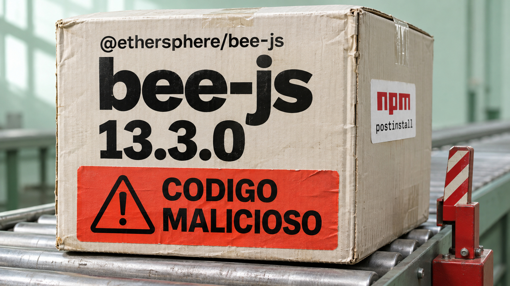

Uma dependência publicada pelo próprio fluxo de releases pode executar código malicioso durante a instalação. Esse é o alerta do caso bee-js, que abre a edição. Também temos uma interface Docker para containers do systemd, proteções contra conflitos entre agentes e novidades em máquinas virtuais, programação e IA local.

## bee-js 13.3.0 levou malware ao npm pelo fluxo legítimo de publicação

A **StepSecurity identificou código malicioso no `@ethersphere/bee-js` 13.3.0**, biblioteca JavaScript para acessar a rede de armazenamento Swarm. O pacote chegou ao npm às **00h09 UTC de 9 de novembro — 21h09 de domingo, dia 8, em Brasília**. Um script `postinstall`, acionado durante a instalação do pacote, baixava e executava código remoto com as permissões do usuário que instalava a biblioteca. A instalação com esses scripts habilitados já acionava o carregador.

Segundo a investigação, o código buscava arquivos da carteira do Swarm Desktop e tentava instalar mecanismos de acesso persistente. A chave da carteira é criptografada, mas o arquivo de configuração pode conter a senha necessária para abri-la. **A quantidade de instalações afetadas e eventuais perdas financeiras ainda não foram estabelecidas.**

O pacote tinha uma atestação válida de procedência: um registro que vincula a publicação ao repositório e ao fluxo automatizado do GitHub Actions. O código malicioso já estava no commit publicado pela identidade de release `bee-worker`. Assim, o fluxo legítimo empacotou código que já havia sido adulterado. A atestação comprova essa origem; verificar a autorização e o conteúdo da mudança exige controles próprios. O modo como os invasores obtiveram acesso continua desconhecido.

A **SafeDep também relata o mesmo carregador no Swarm Desktop 0.56.2**, confirmado no instalador `.deb` para amd64 que examinou. O código é acionado na inicialização do aplicativo. A empresa informa que o npm removeu o bee-js 13.3.0; na consulta ao registro, `latest` apontava novamente para 13.2.0.

Confira os arquivos que fixam as versões das dependências, os *lockfiles*, e os logs de instalação, inclusive de dependências indiretas. Se a versão maliciosa foi instalada com scripts habilitados, investigue a máquina como potencialmente comprometida. Em caso de execução do código malicioso, a orientação da StepSecurity é isolar a máquina, preservar evidências, reconstruí-la de uma imagem confiável e trocar as credenciais expostas a partir de um ambiente limpo. **Excluir a dependência deixa intactos os programas persistentes que ela possa ter instalado.**

Fontes: [análise da StepSecurity](https://www.stepsecurity.io/blog/ethersphere-bee-js-13-3-0-compromise), [investigação da SafeDep, incluindo Swarm Desktop](https://safedep.io/blog/ethersphere-bee-js-npm-compromise) e [versão indicada pelo registro npm](https://registry.npmjs.org/@ethersphere%2fbee-js/latest).

## Nspawn permite usar clientes Docker para gerenciar containers do systemd

Em anúncio de **7 de novembro**, o projeto **Nspawn** detalhou a interface compatível com a Docker Engine API introduzida na versão 3.0. Ela permite que o cliente `docker` e o executor Docker do GitLab Runner gerenciem containers baseados em **systemd-nspawn**, ferramenta para executar ambientes Linux separados no mesmo host.

O cliente envia os pedidos por um socket local, `/run/nspawn/api.sock`, que funciona como ponto de comunicação com o serviço. Por essa interface, consegue criar e iniciar containers, executar comandos, copiar arquivos e administrar volumes e redes. Isso permite reaproveitar automações que já falam o protocolo do Docker.

A compatibilidade tem limites concretos: **`docker build` não funciona por essa API**; o projeto oferece seu próprio `nspawn build`. Envio de imagens, plugins e outras operações também estão fora da interface. O anúncio já aponta a disponibilidade da versão 3.2.0.

O socket vem **desabilitado por padrão**. As permissões passam pelo polkit, mecanismo de autorização do Linux. Segundo o projeto, conceder `org.nspawn.manage` equivale a dar poder de administrador no host, porque permite executar comandos privilegiados e montar caminhos da máquina. Ao adaptar uma automação, confira tanto as operações suportadas quanto quem poderá controlar esse socket.

Fonte: [anúncio do Nspawn e limitações da API](https://blog.nspawn.org/posts/nspawn-3-0-a-docker-compatible-engine-api-for-systemd-nspawn-containers/).

## Bulkhead 0.2.0 verifica comandos para reduzir conflitos entre sessões do Claude Code

Os *worktrees* do Git permitem trabalhar em cópias separadas dos arquivos de um repositório. Dois agentes que usam esses diretórios na mesma máquina ainda compartilham portas de rede, memória e processos. O **Claude Bulkhead** adiciona *hooks*: pequenos programas chamados antes da execução de ferramentas do Claude Code, capazes de barrar um comando e explicar uma alternativa.

A versão **0.2.0, publicada em 8 de novembro**, acrescenta proteções contra varreduras de disco muito abrangentes, exclusão de diretórios usados por outra sessão e inclusão indiscriminada de arquivos no próximo commit. Esse último caso importa quando dois agentes editam o mesmo checkout: um `git add -A` pode carregar também o trabalho inacabado do outro.

Outra novidade é o `bulkhead scan`, que examina comandos de transcrições anteriores e estima quais seriam barrados pelas regras. A análise histórica não reproduz verificações de portas e pouca memória, pois as transcrições não guardam esse estado da máquina.

**Os limites estão na própria documentação:** os hooks reconhecem padrões no texto dos comandos; ações escondidas em scripts ou aliases podem escapar. As reservas de RAM coordenam tarefas, sem impor um teto real de consumo. O projeto ajuda a prevenir colisões comuns entre sessões cooperativas. Trabalhos que exigem isolamento precisam também de controles do sistema operacional.

Fontes: [projeto e funcionamento](https://github.com/dooly6276/claude-bulkhead), [registro da versão 0.2.0](https://api.github.com/repos/dooly6276/claude-bulkhead/releases/latest) e [limitações documentadas](https://raw.githubusercontent.com/dooly6276/claude-bulkhead/main/docs/faq.md).

## Destaques rápidos para hoje.

- **Lima 2.3 ganha driver nativo experimental para hosts Windows.** A versão saiu em **6 de novembro** e recebeu uma apresentação detalhada no dia 8. O Lima gerencia máquinas virtuais locais; o novo driver usa o Host Compute System do Windows, sem depender de QEMU. Por enquanto, permite uma instância por vez e opera sem montagem de arquivos nem encaminhamento dinâmico de portas. No Linux, um auxiliar privilegiado passa a configurar redes pelas quais o host alcança diretamente o IP da VM. Fonte: [anúncio do Lima na CNCF](https://www.cncf.io/blog/2026/11/08/lima-v2-3-native-on-windows-vmnet-on-linux-and-menu-tui/).

- **Um caminho especializado muda o resultado de um teste de C contra Rust no SQLite.** Simon Willison publicou em **8 de novembro** um experimento de conversão de textos formatados em números. A primeira extensão em C perdia nos decimais; uma rotina específica para entradas comuns reduziu o tempo adicional estimado de conversão para **16–19 nanossegundos por linha**, diante de **32–55** nas implementações Rust testadas. O relatório, gerado por IA, usa dois milhões de linhas em uma VM Linux com duas CPUs virtuais. Para chegar a esses valores, seleciona o melhor de 15 testes e desconta o tempo de uma consulta-base. A comparação mostra o peso da implementação nesse trabalho específico. Fontes: [relato de Willison](https://simonwillison.net/2026/Nov/8/sqlite-parse-number-c-vs-rust/) e [método e resultados](https://raw.githubusercontent.com/simonw/research/main/sqlite-parse-number-c-vs-rust/README.md).

- **Implementação em assembly executa Qwen3.5-0.8B em CPU Linux.** O projeto disponibilizado em **8 de novembro** implementa a geração de texto e a preparação dos tokens em assembly x86-64, sem Python ou framework de IA durante a execução. O autor mediu **6,51 tokens por segundo**, contra **4,34** em uma configuração de Transformers/PyTorch. Foram apenas duas execuções de um prompt curto, com uma thread, representações de pesos e caminhos de cálculo diferentes. É material para estudar inferência; o resultado descreve somente essa comparação. Python ainda participa da preparação do build, e o codificador de imagens do modelo não foi implementado. Fonte: [implementação, benchmark e limites](https://raw.githubusercontent.com/suayptalha/qwen3_5-assembly/main/README.md).

- **Servidor de compilação do Casuarina Linux consumiu 98,4 kWh em pouco mais de sete meses.** Wesley Moore publicou a medição em **9 de novembro**: cerca de cinco mil trabalhos de compilação, entre 30 de março e 8 de novembro, em um Ryzen 9 5950X. A tomada inteligente mediu somente esse servidor, que era desligado quando ocioso. Os pacotes eram compilados antes no desktop do autor, cujo consumo ficou fora da conta. Para planejar um laboratório doméstico, a experiência mostra a importância de medir a máquina inteira e contabilizar todas as etapas do trabalho. Fonte: [medições e recorte de Moore](https://www.wezm.net/v2/posts/2026/distro-energy-use/).

- **Curso de Stanford põe alunos para explicar mudanças aos mantenedores.** Em entrevista publicada pelo Latent Space em **8 de novembro**, Mihail Eric descreve a segunda edição do CS146S: os estudantes precisam conhecer um repositório desconhecido, propor uma alteração e explicá-la à pessoa que poderá incorporá-la. A atividade oferece um exercício útil para quem aprende com agentes: conseguir justificar o código e entender sua integração ao projeto faz parte da entrega. Fonte: [entrevista e apresentação da atividade](https://latent.space/p/one_million_ai_engineer_special_how_stanford_teaches_ai-native_engineering_mihail_eric_monaco/).

- **SANS registra aparentes tentativas de burlar a autenticação por senha do OpenSSH no Alpine desde 5 de novembro.** A falha pode permitir login sem conhecer a senha da conta em configurações afetadas do Alpine, que usa a biblioteca de sistema musl. O risco envolve login por senha habilitado e autenticação sem PAM, camada que integra mecanismos de autenticação ao sistema; as condições completas de contas e hashes de senha estão no aviso da distribuição. O diário de **8 de novembro** acrescenta outra observação à [telemetria que cobrimos no dia 7](/2026/libghostty-1-0-ssh-tentativas-memoria-agentes/). Os honeypots Cowrie, sistemas-isca usados pelo SANS, guardavam somente os primeiros 255 caracteres das senhas, limitando a análise. O autor associa os registros à falha identificada no diário como CVE-2026-123158; o sucesso das tentativas ainda não foi confirmado. Quem opera uma configuração afetada deve atualizar o OpenSSH e reiniciar `sshd`, o serviço que recebe as conexões SSH. Fontes: [observação do SANS](https://isc.sans.edu/diary/rss/33498) e [orientação do Alpine](https://alpinelinux.org/posts/2026-11-05-openssh-password-authentication-bypass/).

- **Redox já inicia até um shell no Cloud Hypervisor.** O relato de **8 de novembro** informa a integração do driver Virtio-FS e das mudanças de kernel e boot necessárias para esse ambiente virtualizado. O Virtio-FS permite que a VM acesse diretórios escolhidos no host. O trabalho ainda precisa de etapas como desligamento correto, configuração inicial e testes de implantação antes de virar uma imagem pronta para uso em nuvem. O resultado permite experimentar o sistema operacional escrito em Rust nesse ambiente de virtualização. Fonte: [progresso e próximos passos do Redox](https://www.redox-os.org/news/virtualized-redox/).

> Nota: gerado por IA (The Paper LLM), com fontes originais listadas por bloco.

<!--
briefing_id: 31218
source_urls:
  - https://www.stepsecurity.io/blog/ethersphere-bee-js-13-3-0-compromise
  - https://safedep.io/blog/ethersphere-bee-js-npm-compromise
  - https://registry.npmjs.org/@ethersphere%2fbee-js/latest
  - https://blog.nspawn.org/posts/nspawn-3-0-a-docker-compatible-engine-api-for-systemd-nspawn-containers/
  - https://github.com/dooly6276/claude-bulkhead
  - https://api.github.com/repos/dooly6276/claude-bulkhead/releases/latest
  - https://raw.githubusercontent.com/dooly6276/claude-bulkhead/main/docs/faq.md
  - https://www.cncf.io/blog/2026/11/08/lima-v2-3-native-on-windows-vmnet-on-linux-and-menu-tui/
  - https://simonwillison.net/2026/Nov/8/sqlite-parse-number-c-vs-rust/
  - https://raw.githubusercontent.com/simonw/research/main/sqlite-parse-number-c-vs-rust/README.md
  - https://raw.githubusercontent.com/suayptalha/qwen3_5-assembly/main/README.md
  - https://api.github.com/repos/suayptalha/qwen3_5-assembly
  - https://www.wezm.net/v2/posts/2026/distro-energy-use/
  - https://latent.space/p/one_million_ai_engineer_special_how_stanford_teaches_ai-native_engineering_mihail_eric_monaco/
  - https://isc.sans.edu/diary/rss/33498
  - https://alpinelinux.org/posts/2026-11-05-openssh-password-authentication-bypass/
  - https://www.redox-os.org/news/virtualized-redox/
-->
