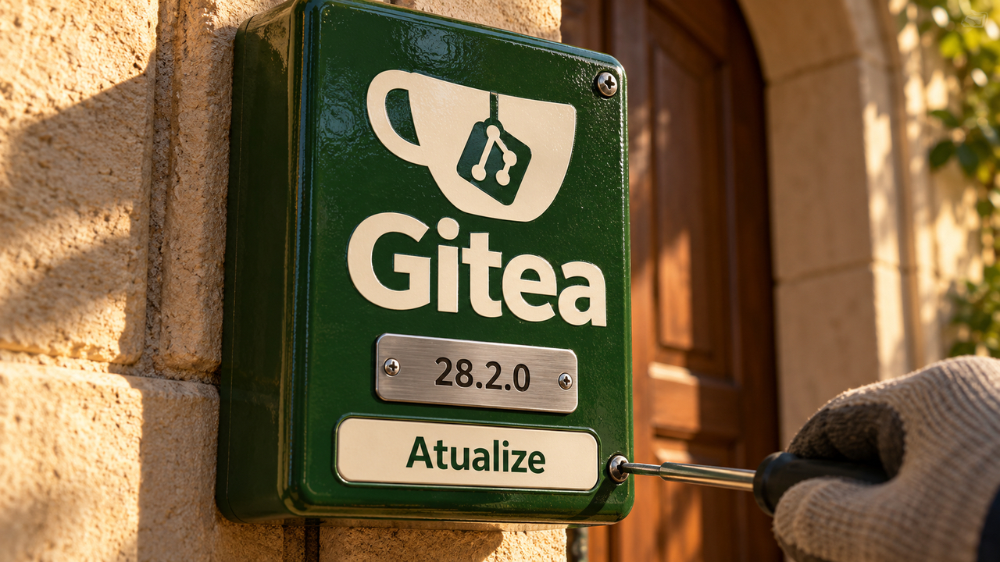

As correções do Gitea abrem a edição com uma ação para quem hospeda repositórios: atualizar a instalação. O Linux 7.3 chega à versão final com o failfs, que ajuda a restringir como programas encontram arquivos. Também há uma proposta para simplificar código gerado por agentes e novidades em diagnóstico, segurança de memória e ferramentas de IA.

## Gitea 28.2.0 corrige falhas que permitiam assumir a identidade de outros usuários

O **Gitea 28.2.0**, lançado em **18 de outubro**, traz correções de autenticação e acesso a dados. O projeto serve para hospedar repositórios Git e automações de desenvolvimento. Seus mantenedores recomendam atualizar o quanto antes.

Uma das falhas, a **CVE-2026-104627**, afeta a associação de identidades OpenID, mecanismo de login por provedor externo. O Gitea aceitava a resposta do provedor sem confirmar que o usuário conectado havia iniciado a associação. Com OpenID habilitado, um atacante podia induzir uma vítima já autenticada a abrir uma resposta preparada e vincular uma identidade controlada por ele à conta dela. Isso permitia entrar como a vítima sem passar pelo segundo fator do login local por senha. A correção exige um valor temporário vinculado ao usuário para confirmar a operação iniciada.

A **CVE-2026-109553** envolve instalações que usam uma autoridade certificadora para autenticar usuários com certificados SSH. Sob condições específicas — aceitar identificadores arbitrários nos certificados ou permitir ao atacante obter um certificado adequado assinado pela autoridade confiável —, a busca confundia tipos de registro e autenticava o pedido como outro usuário. Os dois avisos apontam **28.2.0 como versão corrigida**.

A seção de segurança do anúncio lista doze vulnerabilidades: nove corrigidas agora e três resolvidas anteriormente. Entre as correções atuais estão o vazamento de anexos ao criar um rascunho de release e o consumo excessivo de memória que alguém com um token de runner podia provocar na API de artefatos do Actions. Esses runners executam as tarefas de automação. O conjunto justifica a atualização mesmo para instalações que não usam OpenID.

Fontes: [anúncio do Gitea 28.2.0](https://blog.gitea.com/release-of-28.2.0/), [aviso sobre OpenID](https://github.com/go-gitea/gitea/security/advisories/GHSA-mf69-7pqq-86vx) e [aviso sobre certificados SSH](https://github.com/go-gitea/gitea/security/advisories/GHSA-vcp6-2qc6-gvq3).

## Linux 7.3 chega à versão final com failfs para restringir buscas por arquivos

Linus Torvalds anunciou o **Linux 7.3 em 18 de outubro**. A versão inclui o **failfs**, um sistema de arquivos interno do kernel cujas operações falham. Ele se integra a `fchroot`, interface que permite mudar a raiz usada por um processo para localizar arquivos. A novidade em relação à [cobertura da integração no ciclo de desenvolvimento](/2026/ray-abre-o-shell-pelo-navegador-linux-fecha-a-raiz-e-agente-trapaceia-no-benchmark/) é a chegada à versão final.

O efeito depende de onde o failfs é aplicado. Colocar a **raiz** do processo nele impede buscas por caminhos absolutos, aqueles que começam com uma barra. Colocar o **diretório de trabalho** nele impede buscas relativas a esse diretório. Continuam funcionando as buscas que partem explicitamente de descritores de diretório — referências que o programa já mantém abertas.

Com as duas restrições, o programa precisa dessas referências explícitas para localizar arquivos. Isso ajuda a construir uma *sandbox*, ambiente que limita o acesso de um programa aos recursos do sistema. A adoção exige cuidado: com a raiz no failfs, também falha a busca pelo interpretador necessário para iniciar um binário ligado dinamicamente.

A documentação descreve condições de entrada e formas de sair desse estado que envolvem privilégios e namespaces, os mecanismos de separação de recursos do Linux. Quem constrói o isolamento precisa controlar esses caminhos. **Atualizar o kernel, por si só, não aplica o failfs aos programas existentes.**

Fontes: [anúncio de Torvalds, reproduzido pela LWN](https://lwn.net/Articles/1101170/) e [documentação do failfs na versão 7.3](https://raw.githubusercontent.com/torvalds/linux/v7.3/Documentation/filesystems/failfs.rst).

## Sean Goedecke propõe explicitar quais garantias o agente pode dispensar

Em ensaio de **19 de outubro**, Sean Goedecke argumenta que decidir onde uma aplicação pode aceitar atraso ou dados temporariamente desatualizados ajuda a simplificar sua arquitetura.

O autor relata encontrar alterações geradas por IA que acrescentam travas e verificações para satisfazer exigências que ninguém pediu. Um exemplo é tentar manter duas cópias de um cache perfeitamente sincronizadas quando o produto aceita uma pequena diferença entre elas. A coordenação adicional aumenta o trabalho do sistema e a complexidade da manutenção.

Uma aplicação prática é registrar essas tolerâncias junto dos requisitos: quanto tempo um dado pode ficar desatualizado? Quais tarefas realmente precisam acontecer na mesma ordem para todos? Ao revisar o código, vale perguntar qual garantia acordada cada mecanismo de coordenação protege. A recomendação parte da experiência do autor; as tolerâncias precisam ser decididas por quem conhece o produto e suas obrigações de segurança.

Fonte: [What requirements don't you have?](https://www.seangoedecke.com/what-requirements-dont-you-have/).

## Destaques rápidos para hoje.

- **systemd ganha monitoramento de tráfego Varlink no terminal.** Sebastian Wick apresentou em **18 de outubro** ferramentas recém-incorporadas para observar essa comunicação entre processos. O serviço `io.systemd.VarlinkMonitor` captura mensagens conforme filtros, e `varlinkctl monitor` permite examiná-las no terminal ou exportá-las em JSON para análise. Isso ajuda a investigar quais pedidos um componente envia a outro. A disponibilidade nas distribuições depende de elas incorporarem a novidade. Fonte: [explicação de Wick](https://blog.sebastianwick.net/posts/systemd-varlinkctl-monitor/).

- **Valen experimenta verificar segurança de memória de trás para frente.** Em texto de **18 de outubro**, Evan Ovadia descreve um verificador que analisa cada função do fim ao começo. Ao encontrar o uso de uma referência, registra que ela precisa continuar válida; ao encontrar uma alteração anterior que a invalidaria, sinaliza o problema. A análise busca detectar acessos à memória por referências que deixaram de ser válidas. A linguagem continua experimental, com partes do controle de fluxo ainda por implementar. O ganho de velocidade sugerido pelo autor ainda não foi medido. Fonte: [explicação do algoritmo](https://verdagon.dev/blog/reverse-borrow-checking).

- **Pesquisador reproduz as duas tabelas do RC2 usando pi.** A nota de Khalid Hamadeh, de **18 de outubro**, mostra como embaralhar os números de zero a 255 usando grupos de três dígitos de pi para escolher as trocas. Com dois pontos de partida, o procedimento reproduz as duas tabelas da especificação do algoritmo de criptografia RC2. O documento original dizia que uma delas se baseava em pi, mas não fornecia o método. A correspondência pode ser conferida; a construção histórica exata de Ron Rivest continua sem comprovação. Segundo Hamadeh, o resultado não altera a segurança do algoritmo. Fontes: [pesquisa e procedimento](https://khalidhamadeh.com/writing/rc2-pi-table) e [RFC 2268, seções 2 e 6](https://www.rfc-editor.org/rfc/rfc2268.txt).

- **STROT corrige demonstração e expõe variação entre modelos preparados pela ferramenta.** O projeto Python usa um modelo de linguagem para preparar código e um artefato reutilizável; na execução, um modelo local classifica entradas e pode se abster quando a confiança é baixa. Na atualização de **19 de outubro** da demonstração de Pac-Man, os mantenedores retiraram a afirmação de que a estratégia acompanhava de modo confiável o estado do jogo: novas compilações podiam produzir comportamentos muito diferentes. A proposta permite experimentar a separação entre preparação e execução das decisões, com avaliação específica para cada tarefa antes de uso real. Fontes: [projeto STROT](https://github.com/strot-ai/Project-STROT) e [correção da demonstração](https://github.com/strot-ai/Project-STROT/commit/80cac4bbf627ea1df79f71b8cb36c1784980e52c).

- **Vercel passa a mostrar afinidade de sessão nos logs do AI Gateway.** A visualização anunciada em **18 de outubro** agrupa chamadas a modelos por conversa e mostra custo, modelos, provedores e aproveitamento de cache. A afinidade procura enviar cada rodada ao provedor usado na anterior, que pode já ter boa parte do contexto processada. Para agrupar explicitamente as requisições, a aplicação pode repetir o mesmo `sessionId` em `providerOptions.gateway` ou o cabeçalho `x-session-id`. A novidade ajuda a conferir o reaproveitamento do contexto e as mudanças de provedor ao longo da conversa. Fonte: [anúncio da Vercel](https://vercel.com/changelog/ai-gateway-logs-now-show-session-affinity).

- **llm-tools-datasette 0.1.1 corrige quebra causada por uma dependência indireta.** Publicada em **18 de outubro**, a atualização repara o plugin que conecta o Datasette, ferramenta para explorar e publicar dados, ao LLM, aplicativo para usar modelos de linguagem pelo terminal ou por Python. Simon Willison relata que o plugin usava uma biblioteca HTTP instalada pelo aplicativo principal, sem declará-la como dependência própria. Quando o aplicativo trocou de biblioteca, a integração quebrou. A versão corrige o problema; o caso reforça a importância de declarar as bibliotecas que um plugin usa diretamente. Fontes: [relato do mantenedor](https://simonwillison.net/2026/Oct/18/llm-tools-datasette/), [versão 0.1.1](https://github.com/simonw/llm-tools-datasette/releases/tag/0.1.1), [Datasette](https://datasette.io/) e [documentação do LLM](https://llm.datasette.io/en/stable/).

> Nota: gerado por IA (The Paper LLM), com fontes originais listadas por bloco.

<!--
briefing_id: 28865
source_urls:
  - https://blog.gitea.com/release-of-28.2.0/
  - https://github.com/go-gitea/gitea/security/advisories/GHSA-mf69-7pqq-86vx
  - https://github.com/go-gitea/gitea/security/advisories/GHSA-vcp6-2qc6-gvq3
  - https://lwn.net/Articles/1101170/
  - https://raw.githubusercontent.com/torvalds/linux/v7.3/Documentation/filesystems/failfs.rst
  - https://www.seangoedecke.com/what-requirements-dont-you-have/
  - https://blog.sebastianwick.net/posts/systemd-varlinkctl-monitor/
  - https://verdagon.dev/blog/reverse-borrow-checking
  - https://khalidhamadeh.com/writing/rc2-pi-table
  - https://www.rfc-editor.org/rfc/rfc2268.txt
  - https://github.com/strot-ai/Project-STROT
  - https://github.com/strot-ai/Project-STROT/commit/80cac4bbf627ea1df79f71b8cb36c1784980e52c
  - https://vercel.com/changelog/ai-gateway-logs-now-show-session-affinity
  - https://simonwillison.net/2026/Oct/18/llm-tools-datasette/
  - https://github.com/simonw/llm-tools-datasette/releases/tag/0.1.1
  - https://datasette.io/
  - https://llm.datasette.io/en/stable/
-->
