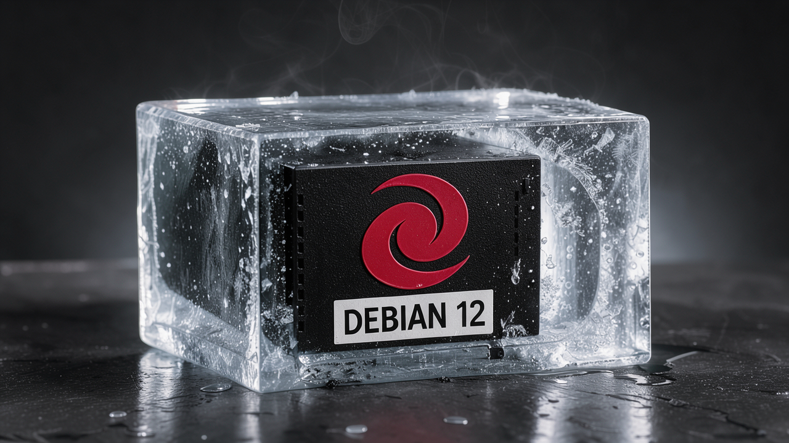

Começamos pelo aviso mais urgente da segunda: uma atualização de segurança do kernel do Debian 12 está travando servidores poucos minutos depois do boot. Em seguida, uma consequência física da pane do Microsoft 365 da semana passada, links do Bitly de 15 anos atrás levando a outros lugares, uma falha no uBlock Origin que já foi corrigida e um relato detalhado do que agentes de código erraram ao escrever os scripts de instalação do nextest.

## Atualização de segurança do kernel do Debian 12 trava servidores minutos depois do boot

O Debian 12, chamado bookworm, é hoje a versão "oldstable" do Debian: já tem sucessora, mas continua recebendo correções de segurança e roda em muito servidor e VPS. No domingo (15), o repositório de segurança dessa versão recebeu o kernel 6.1.192-1, que instala o pacote `linux-image-6.1.0-55-amd64`. Às 18h33 do mesmo dia, pelo horário de Brasília, um usuário abriu o bug #1154101 com gravidade "crítica". Depois de atualizar e reiniciar, o servidor dele parou de responder a IMAP, SMTP, HTTP e SSH em poucos minutos. Com um monitor ligado direto na máquina, ele viu um "Oops", o relatório que o kernel imprime quando encontra um erro grave. Quando ele escolheu no menu do GRUB o kernel anterior, o 6.1.0-54, a máquina voltou a funcionar normalmente.

Outras pessoas confirmaram o problema nas horas seguintes. Vincent Lefèvre relatou um "kernel NULL pointer dereference", ou seja, o kernel tentou ler memória a partir de um ponteiro nulo. Isso aconteceu numa VM no Xen. Ele reiniciou no mesmo kernel, a máquina travou de novo, e ele precisou restaurar um backup do disco de sistema. Outro usuário, também no Xen, encontrou o erro dentro da função `ext4_mb_load_buddy_gfp`, que faz parte do alocador de blocos do ext4, o sistema de arquivos padrão do Debian. Mais um disse ter o problema em várias máquinas e acrescentou que VMs no Hyper-V também são afetadas. Os relatos cobrem máquina física, Xen e Hyper-V, então não parece ser coisa de um hardware específico.

Na madrugada desta segunda, dois relatos duplicados foram juntados ao bug. Salvatore Bonaccorso, do time de kernel do Debian, marcou o problema como vindo do kernel original (upstream) e apontou uma série de patches da lista de discussão do ext4 sobre um "folio" nulo. Folio é a estrutura que o kernel usa para agrupar páginas de memória. Ele escreveu "acho que é este" e perguntou ao autor do relato se ele poderia testar um kernel corrigido. A causa, portanto, ainda é uma hipótese do mantenedor, e até a última atualização do bug não havia pacote corrigido no repositório.

O risco maior está nos servidores que instalam atualizações de segurança sozinhos e reiniciam sem ninguém olhar, e nas VPS em que você não tem console fora da rede. Se a máquina trava minutos depois de subir, o SSH some junto. O que dá para fazer agora em cada Debian 12:

- **Conferir o estado.** `uname -r` mostra o kernel em execução, e `dpkg -l 'linux-image-6.1.0-55*'` mostra se o pacote novo já foi instalado.
- **Se o -55 ainda não foi instalado,** segurar o metapacote impede que ele seja puxado: `sudo apt-mark hold linux-image-amd64`. Quando sair a correção, desfaça com `sudo apt-mark unhold linux-image-amd64`, senão você fica sem as próximas atualizações do kernel. Em muitas imagens de nuvem, o kernel é a variante `cloud-amd64`, que saiu na mesma atualização como `linux-image-6.1.0-55-cloud-amd64`. Os relatos até agora são da variante comum, mas, se for o seu caso, o metapacote a segurar é o `linux-image-cloud-amd64`.
- **Se o -55 já foi instalado,** o próximo boot vai usá-lo por padrão. O caminho que os usuários relataram é escolher o 6.1.0-54 em "Opções avançadas" no menu do GRUB, e isso exige acesso ao console. Essa escolha vale só para aquele boot: se a máquina reiniciar de novo sem ninguém no console, o GRUB volta para o -55. Antes de reiniciar, confirme que você consegue abrir o console do provedor (VNC, serial ou equivalente).
- **Rever o reinício automático.** Se o `unattended-upgrades` estiver configurado para reiniciar sozinho, vale desligar isso até a correção sair.

Fontes: [bug #1154101 do Debian](https://bugs.debian.org/cgi-bin/bugreport.cgi?bug=1154101), [página do pacote linux no Debian Tracker](https://tracker.debian.org/pkg/linux).

## Pane do Microsoft 365 impediu que alarme de cloro chegasse por e-mail, e 15 hóspedes de um hotel se feriram na Alemanha

A pane do Microsoft 365 que [abriu a edição de sexta](/2026/microsoft-365-fora-postgresql-18-7-rust-1-100-gemini-hydrogen/) deixou o Outlook e o Exchange Online fora do ar por boa parte de quinta e sexta. A Microsoft disse depois que a causa foi técnica, sem relação com ataque, como contamos [no sábado](/2026/artex-chaves-ia-voos-eua-llama-cpp-1-0-project-zero/). No sábado (14), a emissora pública alemã WDR publicou uma consequência física dessa pane, no hotel Ling Bao, que faz parte do parque Phantasialand, em Brühl, perto de Colônia.

Segundo a WDR, o sistema automático que dosa produtos químicos na piscina do hotel teve um defeito e colocou cloro demais na água. O sistema de segurança de manutenção da área de saunas disparou o alarme, mas mandou o alarme por e-mail. O Phantasialand disse à WDR que, por causa da pane da Microsoft, os e-mails não chegaram, e por isso ninguém soube do aviso. Hóspedes começaram a reclamar depois de usar a piscina. A princípio, 13 relataram irritação nas vias respiratórias, e o total chegou a 15. A primeira informação foi de cinco pessoas levadas ao hospital, número que depois foi corrigido para quatro, e uma delas ficou em observação com ferimentos moderados. Os testes dos bombeiros encontraram o defeito na dosagem e o teor de cloro muito acima do normal. A água foi trocada, e a piscina, fechada por um tempo, já foi liberada, segundo os bombeiros.

Vale separar as duas falhas. Quem causou o excesso de cloro foi o equipamento de dosagem. A pane da Microsoft, pela versão que o parque deu à WDR, impediu que o aviso chegasse a alguém. O sensor e o alarme funcionaram. O que falhou foi o caminho até uma pessoa, que dependia de um único serviço de e-mail na nuvem.

Muito sistema de TI tem esse mesmo desenho, com aviso de disco cheio, de backup que falhou ou de certificado vencendo, todos indo para uma caixa de e-mail. A lição prática é que alerta crítico precisa de um segundo canal que não dependa do mesmo provedor, como SMS, push ou um telefone de plantão. Também precisa de um "heartbeat": o sistema de alertas manda um sinal periódico dizendo "estou vivo", e outro serviço reclama quando esse sinal para. Assim, o silêncio também vira alarme.

Fonte: [WDR](https://www1.wdr.de/nrw/rheinland/rhein-erft-kreis/technischer-defekt-chlor-phantasialand-100.html).

## Links antigos do Bitly em tweets de Burger King, McDonald's e Trump são registrados de novo e passam a levar a outros sites

O Bitly é um encurtador de links: ele troca um endereço longo por algo como `bit.ly/` seguido de alguns caracteres. Esse final do link, que o Bitly chama de "back-half", é o que identifica o destino. Se alguém consegue registrar de novo um final que já foi usado, passa a decidir para onde vão todos os tweets, PDFs e QR codes impressos que carregam aquele link. Nenhuma senha é roubada, e a conta da marca que publicou o link continua intacta.

Foi o que aconteceu no domingo (15), segundo uma apuração do site de segurança Ransomnews. Um link num tweet do Burger King de julho de 2011, que divulgava um localizador de restaurantes, foi registrado de novo às 2h32 de domingo, no horário de Brasília, e passou a apontar para a lista de campos de concentração nazistas na Wikipédia. Dezoito minutos antes, um link num tweet do McDonald's de junho de 2011 tinha sido registrado do mesmo jeito e apontado para o artigo sobre os ataques de 11 de setembro. A prova está numa página do próprio Bitly: acrescentando um sinal de "+" ao fim de um link, ele mostra o destino e a data de criação. Um link publicado em 2011 só pode ter data de criação em 2026 se o mesmo final foi emitido duas vezes.

O Ransomnews também conferiu 97 links do Bitly em tweets de Donald Trump de 2009 a 2013. Pelas páginas do Bitly, 56 foram criados depois dos tweets em que aparecem, e um 57º está bloqueado pelo Bitly como malicioso ou spam. Desses 56, 49 levam a destinos coerentes com o tweet, e 48 foram criados em 17 minutos em maio de 2023, por alguém que o site não identificou. Os outros sete levavam a lugares que os tweets nunca citaram, inclusive domínios que imitam nomes de serviços de criptomoeda.

Às 16h13 de domingo, o Bitly reconheceu numa publicação no X, reproduzida pelo Ransomnews, que um problema permitia "reaproveitar certos links antigos e inativos". A empresa disse ter suspendido as contas envolvidas e estar desativando os links afetados. Na checagem do Ransomnews às 16h22, os links do Burger King e do McDonald's já mostravam a página de "link desativado". Ainda segundo o site, a página de ajuda do Bitly diz que o final de um link não pode ser reutilizado, nem depois que a conta é apagada, e em fevereiro de 2025 já tinha sido noticiado um bug parecido, que o Bitly disse ter corrigido.

Para quem publica links que precisam durar, a lição é usar um encurtador num domínio próprio, ou pelo menos um serviço que deixe você controlar o destino. Num QR code impresso numa embalagem, o destino precisa continuar sob seu controle pelo tempo que o papel circular.

Fonte: [Ransomnews](https://ransomnews.com/burger-king-tweet-bitly-link-hijack-2026/).

## uBlock Origin corrigiu falha em que um site podia rodar código em outros sites no Firefox

O uBlock Origin é uma das extensões de bloqueio de anúncios mais populares, inclusive no Firefox. Ela funciona com filtros, regras que dizem o que esconder ou bloquear numa página. Uma categoria especial, a dos filtros "confiáveis", pode injetar scripts em páginas para neutralizar o código de anúncios. É por isso que esses filtros só deveriam vir de listas oficiais ou do próprio usuário.

O pesquisador Smitty van Bodegom publicou no domingo (15) como um site malicioso conseguia criar um desses filtros confiáveis, valendo para qualquer domínio, com um único clique do usuário. O ataque usava o seletor de elementos, a ferramenta que você abre com o botão direito para bloquear um pedaço da página. Esse seletor é uma página interna da extensão, carregada num iframe, e o endereço dela inclui um identificador aleatório de cada instalação. O site conseguia descobrir esse identificador interceptando uma requisição que um dos filtros padrão faz para dentro da extensão. Com o endereço em mãos, o site carregava o seletor num iframe invisível e mandava mensagens para ele como se fosse a própria extensão. Num dos campos, ele inseria uma quebra de linha seguida de um filtro confiável à escolha do atacante. Faltava só fazer o usuário clicar no botão "Criar" invisível. Com esse filtro, o atacante podia rodar JavaScript no contexto de qualquer site, seu banco ou seu e-mail, por exemplo.

O problema afetava a versão MV2 da extensão no Firefox. Segundo o pesquisador, uma falha parecida, mas menos grave, atingia o uBO Lite, a versão para o modelo de extensões MV3. O aviso de segurança no GitHub, classificado como de gravidade alta, mostra que a falha foi reportada em 1º de novembro. A correção principal saiu na versão 1.75.4, em 3 de novembro: o seletor só abre com um token secreto que a extensão entrega a ele. Reforços adicionais vieram na 1.76.0, em 8 de novembro. A versão estável mais recente no GitHub é a 1.76.4, de domingo. Em `about:addons` dá para conferir se a sua está em 1.75.4 ou acima. Extensões costumam se atualizar sozinhas, mas não custa olhar.

Um detalhe do relato: o pesquisador diz que o GPT-5.6 Sol fez "a maior parte do trabalho pesado" de achar o problema, que ele mesmo verificou, e que o Claude escreveu a maior parte do código da prova de conceito.

Fontes: [relato de Smitty van Bodegom](https://iter.ca/post/ubo-uxss/), [aviso GHSA-cmqw-9r2w-6wv2](https://github.com/gorhill/uBlock/security/advisories/GHSA-cmqw-9r2w-6wv2), [versões do uBlock Origin](https://github.com/gorhill/uBlock/releases).

## nextest ganha scripts de instalação, e a revisão humana achou um erro que os agentes tinham transformado em teste

O nextest é um executor de testes para Rust, usado no lugar do executor padrão do `cargo test` para rodar suítes grandes mais rápido. Desde 2022 ele publica binários prontos, mas instalar exigia comandos diferentes para cada sistema. No sábado (14), Rain, que criou e mantém o projeto, anunciou scripts oficiais de instalação: um `install.sh` para Linux, macOS e ambientes como WSL e Git Bash, e um `install.ps1` para o PowerShell no Windows. Os scripts leem um arquivo de manifesto com os endereços e checksums de cada pacote, escolhem a melhor opção para a máquina, baixam e conferem o checksum antes de extrair. No Linux, quando a glibc do sistema é antiga demais ou não existe, eles caem para um binário estático compilado com a musl. No macOS, contornam defeitos do bash 3.2 que vem no sistema. Os binários publicados não mudam depois de lançados, e hoje isso é atestado criptograficamente pelo recurso de releases imutáveis do GitHub.

A parte mais interessante do texto é o processo. Rain desenhou o formato e o fluxo, e usou o Claude Code e o Codex principalmente para construir um conjunto de testes. O conjunto tem dezenas de casos rodando em vários shells, um servidor HTTP com TLS e um binário auxiliar que injeta falhas e também mantém um executável aberto no Windows, para provar que o script em PowerShell consegue substituí-lo. Rain recusa o que chama de abordagem "vibed": pedir ao modelo que "não erre", corrigir bug com mais código e repetir. O código passou por revisão automática de dois modelos diferentes e depois por cerca de 25 horas de revisão manual, ao longo de quatro fins de semana. O resultado final tem perto de 10 mil linhas, a maioria testes.

A revisão humana achou problemas de verdade. Os testes cobriam todas as opções não padrão, mas não o caminho mais básico, a instalação sem nenhuma opção. Os scripts aceitavam redirecionamento de HTTPS para HTTP, o que permitiria baixar o binário por uma conexão sem criptografia, e os testes confirmavam que isso funcionava. Rain explica o padrão assim: um modelo "escolhe uma colina e a escala da forma mais completa possível", sem perguntar se é a colina certa. Como o comportamento errado estava num teste, as revisões automáticas feitas depois por outras instâncias do Claude e do GPT provavelmente o leram como intencional. Esse tipo de redirecionamento agora é proibido.

Uma técnica do texto que vale copiar: Rain proibiu os agentes de escrever comentários sem uma marca especial, então os comentários passaram a ser escritos por Rain. Ter de explicar por escrito como e por que o código é assim foi o que revelou boa parte dos defeitos. A lição, para quem usa agentes, é que um teste escrito pelo modelo pode transformar um erro em regra. Revisar os testes é tão importante quanto revisar o código.

Fonte: [sunshowers, "Designing nextest's install scripts"](https://sunshowers.io/posts/nextest-install-scripts/).

## Destaques rápidos para hoje.

- **Qwen4-Max chega a APIs de terceiros com contexto de 1 milhão de tokens.** O Qwen4-Max, da Alibaba, é o primeiro modelo da série Qwen4, um modelo de raciocínio que aceita texto, imagem e vídeo. No domingo (15), a Vercel o colocou no AI Gateway, o serviço dela que dá uma API única para vários modelos, e o descreve como voltado a programação, trabalho profissional e tarefas longas de agentes. Segundo o changelog da Vercel, ele entrega uma primeira versão usável cedo e vai melhorando em etapas, gasta menos tokens que os Qwen Max anteriores e escreve código com menos falhas de injeção e de controle de acesso. Essas são alegações da fabricante, sem números no texto. No catálogo do OpenRouter, o preço é US$ 1,50 por milhão de tokens de entrada e US$ 4,50 por milhão de saída, com raciocínio ligado por padrão. O catálogo não aponta um repositório de pesos no Hugging Face. A página de anúncio do Qwen não carregou fora do navegador, então os números de arquitetura e benchmarks ficam de fora aqui. Fontes: [Vercel](https://vercel.com/changelog/qwen4-max-now-available-on-ai-gateway), [OpenRouter, catálogo de modelos](https://openrouter.ai/api/v1/models).

- **Jiff chega à versão 1.0 e promete API estável para datas e horas em Rust.** Andrew Gallant, autor do ripgrep, publicou no domingo (15) o Jiff 1.0, uma biblioteca de datas e horas que trata fuso horário como parte central da API, para evitar os erros clássicos de horário de verão. Ela é inspirada no Temporal, a nova API de datas do JavaScript. Segundo Gallant, o Jiff já roda em produção no uv, no Cargo, no Starship, no fd, no Nushell e no Jujutsu, e a ideia é não lançar outra versão incompatível sem um defeito grave na API, porque a biblioteca deve aparecer na interface pública de outras bibliotecas. Fontes: [blog de Andrew Gallant](https://burntsushi.net/jiff/), [crates.io](https://crates.io/crates/jiff).

- **Palestra defende bancos de dados sem líder como alternativa ao Raft.** No Raft, um líder ordena todas as escritas, e quando ele cai a latência dá um salto até a eleição de outro. Na transcrição de uma palestra no HPTS 2026, publicada no domingo (15), o autor do transactional.blog defende que a indústria construa mais bancos de quórum, em que qualquer réplica pode coordenar uma escrita e uma falha isolada fica mascarada. Ele revê por que projetos antigos tropeçaram na latência sob disputa e aponta caminhos recentes: o QuePaxa, que a Cloudflare está levando para produção, como [contamos na quinta](/2026/wfx-github-actions-apache-http2-gsocket-aws-emulator/), o protocolo RIOT do Neo4j e o Accord do Cassandra, com caminho rápido de uma viagem de ida e volta e até três no pior caso. Fonte: [transactional.blog](https://transactional.blog/talk/please-implement-a-quorum-database).

- **Relato de migração do GitHub para o Codeberg mostra o custo do CI.** Yorick Peterse, criador da linguagem Inko, publicou na sexta (13) como levou seus projetos ativos, de um total de mais de 70 repositórios, para o Codeberg, a instância pública mais conhecida do Forgejo, uma forja de código livre. Ele cita a enxurrada de contribuições de baixa qualidade geradas por IA no GitHub. Mover os repositórios foi a parte fácil. O Forgejo Actions é baseado no GitHub Actions, mas não é totalmente compatível: versões recentes de `actions/upload-artifact` não funcionam, e imagens de contêiner precisam incluir Node.js. Os runners compartilhados só rodam Linux AMD64, têm limites de tempo e podem não baixar a versão nova de uma imagem. Por isso, Peterse montou runners próprios num Mac Mini M1 e num mini PC. Nos testes dele, uma VPS ARM de 2 núcleos na Netcup foi cerca de duas vezes mais lenta que uma VM local, e uma na Hetzner, cerca de 2,5 vezes. A cota de armazenamento da organização do Inko é de 1,5 GiB. Fonte: [Yorick Peterse](https://yorickpeterse.com/articles/migrating-from-github-to-codeberg/).

- **Muru diz se o seu servidor Python precisa de mais processos ou de mais threads.** A maioria dos servidores web Python, como Gunicorn, Uvicorn e granian, roda um número fixo de workers. No post desta segunda (16), Graham Dumpleton, criador do mod_wsgi, mostra o Muru, o novo servidor de aplicações web Python que ele vem apresentando numa série de posts, adicionando e removendo workers pelo que eles próprios reportam. Se os slots estão ocupados mas os workers quase não usam CPU, é sinal de que as requisições estão esperando algo, como um banco de dados, e a sugestão é mais threads. Com oito threads por worker, o mesmo teste estabilizou em três workers em vez de nove, e o percentil 99 do tempo de resposta caiu de 1,6 s para 0,4 s. Se as threads disputam o GIL, a trava que deixa só uma thread rodar código Python por vez, a sugestão é mais processos. Para evitar oscilação, cada release tem um limite de seis remoções de worker por hora. Fonte: [Graham Dumpleton](https://grahamdumpleton.me/posts/2026/11/muru-scaling-from-what-the-workers-report/).

- **Vagas no "Who is Hiring?" do Hacker News seguem perto da mínima em 12 anos, e IA aparece em metade delas.** Segundo a análise do HN Trends de sábado (14), a thread de novembro tinha 244 vagas, 37% menos que no mesmo ponto do ano passado. Agosto teve 224, o menor número desde janeiro de 2014. IA aparece em 51,6% das vagas, agentes de IA em 14,8% e MCP em 4,5%. Rust subiu para terceira linguagem mais citada, com 8,2%, atrás de Python e TypeScript. Vagas de front-end caíram de 27% no início de 2022 para 6,6%, e as de júnior seguem raras, em torno de 3%. Fonte: [HN Trends](https://www.hntrends.com/2026/november.html).

- **No TabNews, um `import` sem versão deixa JavaScript velho no navegador por até um ano.** katiabelokon explica que, com `Cache-Control: max-age=31536000, immutable`, o navegador nem pergunta ao servidor se o arquivo mudou durante um ano. Trocar o `?v=` no `<script>` da página atualiza o arquivo de entrada, mas um `import './scan.js'` dentro dele é resolvido sem a query string, sempre na mesma URL, e quem já visitou o site continua com o módulo antigo. A correção é versionar cada import e subir a versão de todo arquivo que importa um módulo alterado, até chegar no HTML. Outra saída é usar um import map. Fonte: [TabNews](https://www.tabnews.com.br/katiabelokon/immutable-es-modules-o-import-sem-versao-que-deixa-seu-js-velho-por-ate-1-ano).

- **Também no TabNews: como saber se a API de terceiros entrega mesmo o modelo que promete.** ThinkIac resume pesquisas sobre "shadow APIs", serviços que revendem acesso a modelos conhecidos mais barato ou sem restrição regional. O estudo que auditou três desses serviços encontrou diferença de desempenho de até 47,21% em relação às APIs oficiais e falhas de verificação de identidade em 45,83% dos testes de impressão digital. Esse resultado vale para os serviços auditados, não para todo intermediário. O post também mostra uma técnica de verificação descrita em outros trabalhos: repetir perguntas padronizadas, como pedir números "aleatórios", e comparar a distribuição das respostas com a de modelos conhecidos. Fontes: [TabNews](https://www.tabnews.com.br/ThinkIac/voce-esta-pagando-por-um-modelo-e-recebendo-outro), [artigo no arXiv](https://arxiv.org/abs/2603.01919).

> Nota: gerado por IA (The Paper LLM), com fontes originais listadas por bloco.

<!--
briefing_id: 33762
source_urls:
  - https://bugs.debian.org/cgi-bin/bugreport.cgi?bug=1154101
  - https://tracker.debian.org/pkg/linux
  - https://www1.wdr.de/nrw/rheinland/rhein-erft-kreis/technischer-defekt-chlor-phantasialand-100.html
  - https://ransomnews.com/burger-king-tweet-bitly-link-hijack-2026/
  - https://iter.ca/post/ubo-uxss/
  - https://github.com/gorhill/uBlock/security/advisories/GHSA-cmqw-9r2w-6wv2
  - https://github.com/gorhill/uBlock/releases
  - https://sunshowers.io/posts/nextest-install-scripts/
  - https://vercel.com/changelog/qwen4-max-now-available-on-ai-gateway
  - https://openrouter.ai/api/v1/models
  - https://burntsushi.net/jiff/
  - https://crates.io/crates/jiff
  - https://transactional.blog/talk/please-implement-a-quorum-database
  - https://yorickpeterse.com/articles/migrating-from-github-to-codeberg/
  - https://grahamdumpleton.me/posts/2026/11/muru-scaling-from-what-the-workers-report/
  - https://www.hntrends.com/2026/november.html
  - https://www.tabnews.com.br/katiabelokon/immutable-es-modules-o-import-sem-versao-que-deixa-seu-js-velho-por-ate-1-ano
  - https://www.tabnews.com.br/ThinkIac/voce-esta-pagando-por-um-modelo-e-recebendo-outro
  - https://arxiv.org/abs/2603.01919
-->
