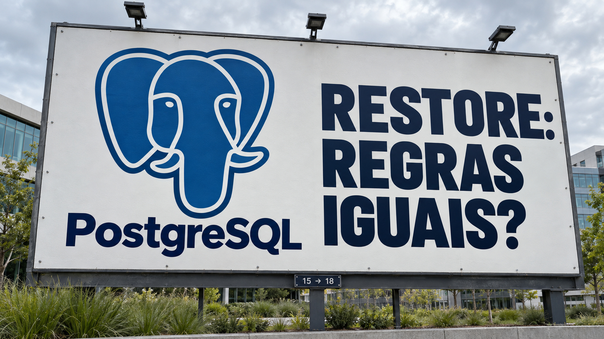

Onde os dados ficam quando uma aplicação é substituída? E as regras do banco continuam funcionando depois de uma restauração? Dois relatos desta edição mostram por que essas perguntas precisam entrar no teste de migração. A equipe do Claude Code também conta como mudou a revisão por agentes depois de uma alteração atravessar mais de 50 rodadas. Nos destaques rápidos, há correções de segurança, ferramentas para Go e novidades de infraestrutura para IA.

## Fairwinds migra n8n no Kubernetes e dispensa o disco do componente principal

Em relato de **16 de outubro**, a Fairwinds descreveu a migração do n8n, ferramenta de automação de fluxos, no Amazon EKS, serviço de Kubernetes da AWS. A equipe trocou um Helm chart comunitário — pacote que descreve como implantar a aplicação — pelo oficial. Na configuração adotada, o novo pacote previa um disco compartilhado entre instâncias do componente principal, mas o disco usado não podia ser conectado a vários nós do cluster.

Para decidir o que fazer, a equipe conferiu onde vivia o estado da aplicação, isto é, o que precisava sobreviver à substituição das instâncias. Naquela instalação, o **PostgreSQL guardava os fluxos e os dados de execução; o Redis, os trabalhos na fila; o S3, os arquivos; e o Secrets Manager, a chave de criptografia e os segredos**. O disco do componente principal não continha nada que precisasse persistir. A equipe desabilitou esse disco, e as novas instâncias puderam se reconectar aos serviços externos.

Antes de mudar o tráfego de produção, a Fairwinds restaurou uma cópia do banco em um ambiente de testes, verificou os fluxos e testou a volta à implantação anterior. Também **manteve a mesma versão do n8n**, separando a troca de implantação de uma possível migração de banco. O inventário do estado é o que sustenta a decisão de remover um volume; outra configuração pode precisar dele.

Fonte: [relato de Husne Ozmen, da Fairwinds, no blog da CNCF](https://www.cncf.io/blog/2026/10/16/deploying-maintaining-and-migrating-production-n8n-on-eks/).

## PostgreSQL: restauração entre versões pode mudar o significado de uma regra

Christophe Pettus publicou em **16 de outubro** um exemplo em que uma regra do banco é restaurada, mas passa a verificar outra coisa. O `pg_dump`, ferramenta que exporta o banco, participa da geração do SQL junto com o servidor de origem. Cada um usa a lista de palavras reservadas da sua versão.

No exemplo, o `pg_dump` 18 exporta um banco PostgreSQL 15 com uma coluna chamada `system_user`. A ferramenta coloca aspas no nome ao declarar a coluna, mas o servidor 15 deixa o nome sem aspas dentro de uma restrição `CHECK`, regra que valida os dados. **Desde o PostgreSQL 16, `SYSTEM_USER` tem significado próprio: representa a identidade autenticada da conexão.** Ao restaurar no 18, a regra passa a comparar essa identidade com uma string vazia e deixa de impedir valores vazios na coluna. Uma política que controla quais linhas cada usuário pode consultar também muda de comportamento. Já o índice do exemplo falha com erro: os efeitos variam conforme o objeto restaurado.

A documentação recomenda **`--quote-all-identifiers`** quando a versão principal do `pg_dump` difere da origem ou quando o destino usa outra versão principal. As aspas preservam a interpretação de `"system_user"` como nome da coluna. A proteção alcança as expressões que compõem o dump; consultas da aplicação e corpos de funções PL/pgSQL armazenados como texto continuam exigindo revisão. No teste de migração, confira também o comportamento: dados inválidos ainda são rejeitados? Cada usuário continua enxergando as linhas corretas?

Fontes: [demonstração de Pettus](https://thebuild.com/blog/all-your-gucs-in-a-row-quote_all_identifiers/) e [documentação do `pg_dump`](https://www.postgresql.org/docs/18/app-pgdump.html).

## Equipe do Claude Code pede reavaliação após três rodadas de revisão

Em texto de **15 de outubro**, a equipe do Claude Code, assistente de programação da Anthropic, relatou uma proposta de alteração de código, ou pull request, que atravessou **mais de 50 rodadas de revisão e correção durante uma noite**. Um agente fazia alterações e outro continuava encontrando problemas. Cerca de 59% do código apontado já estava presente na primeira passagem: parte do trabalho era descobrir aos poucos problemas que poderiam ter sido encontrados antes.

A equipe passou a **pedir ao autor que reconsidere a abordagem após três rodadas**. Depois das primeiras passagens, a revisão se concentra nas novas alterações, e achados já publicados não se repetem. A quantidade de rodadas até a aprovação passou a ser acompanhada junto com a capacidade de encontrar bugs.

A Anthropic relata que os PRs integrados mais que dobraram de junho a setembro, enquanto a proporção revertida caiu mais de 40%. São observações internas de um processo que combina testes, revisão automatizada, aprovação humana conforme o risco e reversão rápida; os números não isolam o efeito de cada camada. Para adotar revisão por agentes, vale medir tanto os erros que escapam quanto as sugestões prejudiciais e o trabalho necessário até concluir a revisão.

Fonte: [relato da equipe do Claude Code](https://claude.dev/blog/solving-code-review-at-anthropic/).

## Destaques rápidos para hoje.

- **X.Org corrige 17 vulnerabilidades em cinco bibliotecas de aplicações gráficas.** O boletim de **16 de outubro** lista **libX11 1.8.14, libXi 1.8.4, libXpm 3.5.20, libXrender 0.9.13 e libXtst 1.2.6** como versões corrigidas. Várias falhas envolvem respostas manipuladas de servidores X ou de métodos de entrada, com acessos indevidos à memória e travamentos; a falha em libXpm envolve imagens XPM preparadas. Confira os pacotes corrigidos da sua distribuição. Para desenvolvedores, o projeto reforça a separação entre a interface gráfica e o código que precisa de privilégios. Fonte: [aviso de segurança do X.Org](https://lists.x.org/archives/xorg-announce/2026-October/003752.html).

- **Percona associa picos de escrita do Galera ao cache de páginas do Linux.** A investigação de **16 de outubro** examinou um ambiente que havia atualizado o banco e o sistema operacional. A análise por thread apontou para o cache do Galera, componente que replica mudanças entre servidores de banco. Segundo o autor, pequenas alterações nesse cache, acessado por mapeamento de memória, podiam marcar unidades maiores, chamadas *folios*, para gravação em disco, ampliando a escrita em XFS. O efeito depende do kernel, do sistema de arquivos e do padrão de acesso. O caso mostra a importância de separar a atividade dos componentes antes de atribuir uma regressão à nova versão do banco. Fonte: [investigação da Percona](https://www.percona.com/blog/when-a-small-change-writes-too-much-how-a-linux-kernel-improvement-can-strike-you-in-pxc-galera-workloads/).

- **Big Fish detalha elevação local de privilégios no OpenBSD, já corrigida.** A Calif divulgou em **16 de outubro** uma cadeia de falhas no gerenciamento de memória que permite obter root, a conta administrativa, a partir de acesso local. Segundo a pesquisa, proteções do kernel permaneciam habilitadas na demonstração. No **OpenBSD 7.9**, as correções **018 e 026** foram publicadas em **14 e 30 de setembro**; administradores devem conferir as erratas aplicáveis. A novidade de outubro é a análise pública da exploração. Fontes: [pesquisa da Calif](https://calif.io/research/big-fish), [errata 018](https://ftp.openbsd.org/pub/OpenBSD/patches/7.9/common/018_shmat.patch.sig) e [errata 026](https://ftp.openbsd.org/pub/OpenBSD/patches/7.9/common/026_sysvipc.patch.sig).

- **GNOME OS Preview adota o desktop estável, ainda sem garantia de atualização permanente.** Anunciada em **16 de outubro**, a edição usa o **GNOME 51.1**, enquanto a Nightly acompanha os commits mais recentes. A Preview é voltada a entusiastas dispostos a testar, e uma futura passagem para GNOME OS Stable pode exigir reinstalação. O novo instalador e a integração com `systemd-homed`, para gerenciamento de diretórios pessoais, continuam em desenvolvimento. Fonte: [anúncio de Adrian Vovk](https://blogs.gnome.org/adrianvovk/2026/10/16/gnome-os-preview/).

- **Go apresenta refatorações que perguntam antes de editar.** O anúncio de **16 de outubro** mostra o `gopls`, servidor que fornece recursos de Go ao editor, coletando escolhas como tags de serialização e convenções de nomes. O suporte está disponível com **gopls 0.24.0 e extensão Go 0.56.0 do VS Code**. A colaboração com a equipe de Dart propõe estender o LSP, protocolo de comunicação entre editores e servidores de linguagem. Mover declarações aparece como prévia para uma versão futura; mudar assinaturas está no roteiro de desenvolvimento. Fonte: [Go Blog](https://go.dev/blog/interactive-refactoring).

- **Pesquisa reproduz as sementes usadas para gerar cinco curvas criptográficas do NIST.** Em **16 de outubro**, a Anthropic publicou uma reconstrução dos valores usados na geração das curvas P-192, P-224, P-256, P-384 e P-521. O procedimento usa um gerador pseudoaleatório inicializado com horários de 1997 e 1998. Filippo Valsorda relata ter reimplementado o algoritmo e verificado o resultado. A pesquisa trata da procedência dos parâmetros públicos dessas curvas; permanece sem explicação o descarte de alguns candidatos válidos. Segundo os autores, o resultado não exige mudança operacional de quem as utiliza. Fontes: [pesquisa da Anthropic](https://www.anthropic.com/research/ecdsa-curve-origins) e [verificação de Valsorda](https://words.filippo.io/seeds-solved/).

- **Shelly 3.1.7 adiciona um motor de pacotes escrito em Zig.** O gerenciador para sistemas da família Arch Linux disponibiliza o **RLPM**, implementação independente para resolver dependências e executar operações com pacotes nativos. Os builds padrão do projeto continuam selecionando **libalpm**, a biblioteca tradicional usada pelo pacman; variantes compiladas sem ela usam RLPM. Para avaliar a alternativa, confira qual variante instalou e comece em um ambiente descartável: o motor de pacotes cuida de uma parte central da administração do sistema. Fonte: [notas da versão 3.1.7](https://github.com/Seafoam-Labs/Shelly-ALPM/releases/tag/v3.1.7).

- **Apple documenta inferência distribuída com MLX em quatro Mac Studios.** No guia de **15 de outubro**, a empresa mede **36,73 tokens por segundo** para Muse Spark Open usando **quatro máquinas M5 Ultra**, paralelismo de tensores e comunicação RDMA por Thunderbolt. O teste usa pesos em **NVFP4, de quatro bits**, contexto de **8.192 tokens** e geração de **128 tokens**. MLX é a estrutura de computação da Apple para aprendizado de máquina; dividir o trabalho entre as máquinas permite acomodar pesos e cálculos que excedem uma só. O resultado se refere a esse conjunto de hardware e configuração. Fonte: [guia e tabelas da Apple](https://machinelearning.apple.com/research/mlx-distributed-inference).

- **Google Cloud publica receitas para servir Reflection Beam reutilizando o contexto.** O guia de **16 de outubro** combina roteamento que considera o cache, separação entre processamento do prompt e geração de tokens, e armazenamento de cache em RAM e SSD. Em uma sessão longa de agente, encaminhar a próxima chamada à réplica que já processou o histórico reduz a repetição de cálculos. As receitas usam llm-d com vLLM ou NVIDIA Dynamo com SGLang. Os ganhos anunciados vêm de benchmarks de cliente: os conjuntos usam hardware diferente, e cada um deve ser comparado à sua própria configuração de referência. Fonte: [arquitetura e condições dos testes no Google Cloud](https://cloud.google.com/blog/topics/ai-infrastructure/day-0-support-with-5x-perf-for-reflection-beam-on-google-cloud/).

- **Cloudflare começa a avaliar continuamente o comportamento dos bots verificados.** O sistema anunciado em **16 de outubro** observa padrões de respeito às preferências de rastreamento do `robots.txt` e a respostas HTTP **429**, que indicam excesso de requisições. A empresa já o utiliza internamente e planeja publicar avaliações no Radar e permitir que clientes escolham um limiar de confiança para tratar esse tráfego. A disponibilização pública ainda é um plano. Para quem escreve crawlers, vale conferir se o programa respeita as preferências e os limites de cada site ao longo das visitas. Fonte: [anúncio da Cloudflare](https://blog.cloudflare.com/verified-bots-accountability/).

> Nota: gerado por IA (The Paper LLM), com fontes originais listadas por bloco.

<!--
briefing_id: 28761
source_urls:
  - https://www.cncf.io/blog/2026/10/16/deploying-maintaining-and-migrating-production-n8n-on-eks/
  - https://thebuild.com/blog/all-your-gucs-in-a-row-quote_all_identifiers/
  - https://www.postgresql.org/docs/18/app-pgdump.html
  - https://claude.dev/blog/solving-code-review-at-anthropic/
  - https://lists.x.org/archives/xorg-announce/2026-October/003752.html
  - https://www.percona.com/blog/when-a-small-change-writes-too-much-how-a-linux-kernel-improvement-can-strike-you-in-pxc-galera-workloads/
  - https://calif.io/research/big-fish
  - https://ftp.openbsd.org/pub/OpenBSD/patches/7.9/common/018_shmat.patch.sig
  - https://ftp.openbsd.org/pub/OpenBSD/patches/7.9/common/026_sysvipc.patch.sig
  - https://blogs.gnome.org/adrianvovk/2026/10/16/gnome-os-preview/
  - https://go.dev/blog/interactive-refactoring
  - https://www.anthropic.com/research/ecdsa-curve-origins
  - https://words.filippo.io/seeds-solved/
  - https://github.com/Seafoam-Labs/Shelly-ALPM/releases/tag/v3.1.7
  - https://machinelearning.apple.com/research/mlx-distributed-inference
  - https://cloud.google.com/blog/topics/ai-infrastructure/day-0-support-with-5x-perf-for-reflection-beam-on-google-cloud/
  - https://blog.cloudflare.com/verified-bots-accountability/
-->
