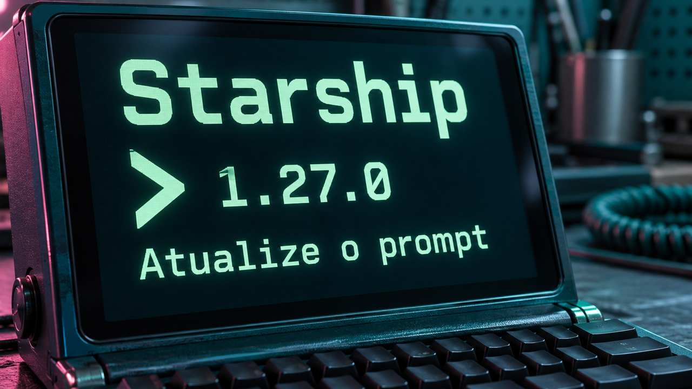

O Starship publicou duas correções de segurança para operações que acontecem automaticamente ao montar o prompt do terminal. No libkrun, uma proposta experimental reduziu em 28% o tempo de uma compilação ao mudar como a máquina virtual atende pedidos de acesso a arquivos. A edição também traz a atualização do DeepSeek Flash, mudanças em ferramentas de desenvolvimento e alertas para quem opera agentes e infraestrutura.

## Starship 1.27.0 corrige riscos de execução de comandos e consumo de memória

O **Starship** monta o prompt — a área do terminal que indica onde você vai digitar um comando — com informações como branch e linguagem do projeto. A versão **1.27.0, lançada em 17 de outubro**, corrige duas falhas nesse trabalho automático de consultar o ambiente.

A primeira envolve a chamada ao executável do Git. O Starship passava uma opção que fazia o Git pular sua verificação de propriedade do repositório. Segundo o aviso, isso permitia que configurações de um repositório pertencente a outro usuário da máquina provocassem execução de comandos com as permissões de quem abria o terminal naquela pasta. O caminho afeta a configuração padrão desde a **1.17.0**; com o módulo opcional `git_metrics`, o intervalo começa na **1.1.0**. A **1.26.0** ainda está entre as versões afetadas.

A segunda falha está na leitura de metadados do projeto. Um link simbólico — arquivo que aponta para outro destino — podia levar o prompt a uma leitura sem limite, consumir memória continuamente e impedir sua conclusão. O relatório reproduziu o problema em Linux e macOS com a configuração padrão; Windows não foi avaliado.

**Quem usa Starship deve atualizar para 1.27.0 ou conferir o pacote corrigido da distribuição.** O risco aparece durante a montagem automática do prompt, antes de o usuário executar comandos do projeto. A versão também acrescenta módulos para o controle de versões Jujutsu e suporte a prompt à direita no Bash.

Fontes: [notas da versão](https://github.com/starship/starship/releases/tag/v1.27.0), [aviso sobre a chamada ao Git](https://github.com/starship/starship/security/advisories/GHSA-679r-jwc5-r5m3) e [aviso sobre consumo de memória](https://github.com/starship/starship/security/advisories/GHSA-x486-6jjc-phfp).

## Experimento do libkrun reduz em 28% o tempo de uma compilação com filas síncronas

Sergio Lopez abriu em **16 de outubro** uma proposta experimental para o **libkrun**, biblioteca usada para executar máquinas virtuais. A mudança atua no **VirtIO-FS**, mecanismo que permite à máquina virtual acessar arquivos compartilhados pelo sistema hospedeiro.

No caminho habitual, o processador virtual entrega o pedido, outra thread — uma linha de execução do programa — faz o trabalho e uma interrupção avisa que a resposta está pronta. A proposta cria uma fila por processador virtual e atende o pedido na própria thread que o enviou. É por isso que o caminho é chamado de síncrono: quando essa thread retorna ao sistema convidado, a resposta já está disponível. Assim, há menos transferências de trabalho e notificações entre threads.

No teste publicado pelo autor, compilar o firmware libkrunfw em uma máquina virtual com **oito processadores virtuais, num Mac M3 Pro**, caiu de **7 minutos e 44 segundos para 5 minutos e 34 segundos**: aproximadamente **28% menos tempo**. A medição se limita a essa compilação e configuração.

Enquanto o pedido é atendido, aquele processador virtual fica ocupado com ele. A troca a avaliar é entre esse tempo de ocupação e a economia nas transferências de trabalho. A proposta ainda está em rascunho e exige suporte correspondente no sistema convidado; o teste oferece um resultado concreto para investigar esse equilíbrio em outras cargas.

Fonte: [proposta e medições de Lopez no libkrun](https://github.com/libkrun/libkrun/pull/933).

## DeepSeek atualiza o Flash e relata ganhos em tarefas com ferramentas

O **DeepSeek-V4.1-Flash-1017**, disponibilizado em **17 de outubro**, atualiza o modelo Flash com melhorias declaradas em raciocínio, programação e tarefas com ferramentas. Na tabela do fornecedor, a pontuação no **Terminal-Bench 4.0** passa de **31,2 para 42,3**, usando o **Claude Code como ambiente de execução do agente**. A DeepSeek também relata respostas mais curtas e menor tempo para concluir tarefas. São avaliações do próprio fornecedor, úteis como ponto de partida para testar o modelo nas tarefas da sua aplicação.

Para quem executa o modelo por conta própria, há um detalhe importante: o lançamento **não inclui um template de chat em Jinja**, formato comum para transformar mensagens em entrada do modelo. Ele fornece uma implementação de referência em Python e o **deepseek-recipe**, conjunto de bibliotecas Rust com interface para Python.

Esse conjunto prepara as mensagens no formato esperado pelo modelo e interpreta as respostas, incluindo pedidos de uso de ferramentas e conteúdo recebido aos poucos. **Executar o modelo, acionar as ferramentas e fazer a comunicação HTTP continua sendo responsabilidade da aplicação.** Ao adaptar um agente, teste o ciclo completo: o pedido de uma ferramenta, a execução pela aplicação, a devolução do resultado e a continuação da conversa.

Fonte: [cartão técnico e documentação do lançamento](https://huggingface.co/deepseek-ai/DeepSeek-V4.1-Flash-1017).

## Destaques rápidos para hoje.

- **PostgreSQL: análise explica grandes diferenças no custo estimado de consultas.** Em texto de **17 de outubro**, Christophe Pettus compara consultas que retornam quantidades parecidas de linhas, mas recebem estimativas cerca de 80 vezes diferentes. Esses números são estimativas usadas para escolher o plano de execução. A diferença está na relação entre a ordem do índice e a disposição física das linhas: acessos mais sequenciais recebem outro custo. O parâmetro `random_page_cost` também incorpora expectativas de cache. Antes de alterá-lo, observe os planos e as leituras reais; a sugestão de **1,1** do autor pressupõe uma carga transacional cujo conjunto de dados acessado cabe em memória, em armazenamento SSD. Fontes: [análise de Pettus](https://thebuild.com/blog/all-your-gucs-in-a-row-random_page_cost-and-seq_page_cost/) e [documentação de custos do planejador](https://www.postgresql.org/docs/current/runtime-config-query.html).

- **OWASP remove exemplos de troca de chaves que não autenticavam os participantes.** A alteração incorporada em **17 de outubro** substitui exemplos próprios de criptografia nos guias de Java e .NET por orientação para usar **TLS** no transporte e bibliotecas mantidas quando a mensagem precisa continuar cifrada além da conexão. Criptografar uma mensagem para uma chave pública exige confiar que a chave pertence ao destinatário correto. O guia também explica que o modo básico de HPKE, um esquema de criptografia híbrida, não autentica o remetente nem impede que uma mensagem seja reapresentada. Assinaturas e detecção de duplicatas precisam entrar no desenho quando essas garantias forem necessárias. Fontes: [alteração da OWASP](https://github.com/OWASP/CheatSheetSeries/pull/2800) e [guia de segurança Java](https://cheatsheetseries.owasp.org/cheatsheets/Java_Security_Cheat_Sheet.html).

- **Imprint cria aprovação acelerada com elegibilidade conferida pelo sistema de integração.** Will Larson relata, em **17 de outubro**, que a mediana de revisão passou de 33 para 77 minutos enquanto o volume médio de propostas de alteração por engenheiro quadruplicou em dois anos. O fluxo `small-change` exige menos de mil linhas, ausência de achados automatizados de prioridade 1 ou 2, experiência prévia do autor e limites de serviços afetados; bibliotecas compartilhadas ficam de fora. Uma verificação automática no processo de build determina a elegibilidade; colocar a etiqueta `small-change` na proposta, por si só, não libera a aprovação acelerada. Apenas cerca de 10% das mudanças se qualificavam no começo, e o autor considera cedo para avaliar o resultado. Fonte: [relato de Larson](https://lethain.com/small-changes/).

- **OpenCode informa incidente em contas do Console com provedores externos vinculados.** No comunicado atualizado de **17 de outubro**, a equipe afirma que uma violação de segurança atingiu **1,4% dos usuários do OpenCode Console**, dentro desse grupo de contas. Segundo a empresa, os afetados foram avisados por e-mail e a resposta ao incidente envolvia Anthropic, OpenAI e Google. O comunicado ainda descrevia o caso como em andamento, sem detalhar o mecanismo ou os dados comprometidos. Para quem usa o Console, cabe conferir a notificação oficial e a atividade das contas vinculadas. Fonte: [comunicado atualizado do OpenCode](https://twitter.com/opencode/status/2111519637049319818).

- **Pesquisa PwnEscape detalha fuga de máquina virtual por uma falha na rede do Linux.** A pwn.ai descreve como metadados de um cálculo de verificação de pacotes podiam alterar um cabeçalho depois de ele já ter sido validado. A equipe relata leitura de memória do hospedeiro e execução de código administrativo em laboratório. A Vercel confirma o vazamento de memória em seus ambientes isolados de produção e situa a execução de código nas máquinas dos pesquisadores. Segundo a empresa, os relatos não demonstraram acesso a arquivos, segredos ou dados de aplicações de clientes. O kernel, núcleo do Linux, recebeu o commit **`6785011f8b16`** para validar esses metadados em caminhos IPv4. Os mantenedores o descrevem como uma camada de defesa e dizem que uma validação mais completa na entrada ainda exige trabalho. Quem administra hospedeiros deve conferir a incorporação desse patch pelo fornecedor; as fontes não estabelecem uma versão corrigida única para todas as distribuições. Fontes: [pesquisa](https://pwn.ai/blog/pwnescape), [relato da Vercel](https://vercel.com/blog/findings-from-the-1-million-dollar-vercel-sandbox-challenge) e [patch no Linux](https://github.com/torvalds/linux/commit/6785011f8b16abf40b1e9d8b2e332232b3e68822).

- **DeepSeek documenta busca e leitura de páginas para agentes.** A API Search devolve resultados estruturados; a Fetch busca uma página e entrega seu conteúdo em Markdown. A documentação anuncia **US$ 0,75 por mil requisições bem-sucedidas em cada serviço**; buscas vazias, falhas e timeouts ficam fora da cobrança. Para chamadas de ferramentas feitas no servidor por DeepSeek Harness, Claude Code ou Codex, o guia informa gratuidade atual e início da cobrança em **1º de novembro, à meia-noite de Pequim**. Isso permite separar o custo de obter conteúdo do custo de processá-lo no modelo. Fonte: [documentação Search & Fetch](https://api-docs.deepseek.com/guides/search/).

- **Touri 0.2.0 leva seu aplicativo de agentes persistentes ao Linux x86_64 em prévia.** A versão de **17 de outubro** oferece pacotes para organizar conversas, rotinas e aprovações usando ferramentas como Codex e Claude Code. O estado local fica em SQLite, e credenciais usam o chaveiro do sistema. As notas registram limites importantes: a restrição de acesso a pastas de bots locais e a auditoria de dependências Linux continuam pendentes; o controle do computador hospedeiro está indisponível no Linux, e não há pacotes nativos ARM64 nessa versão. É uma opção para experimentar em ambiente descartável, com contas e arquivos de teste. Fontes: [notas da prévia](https://github.com/touri-ai/touri/releases/tag/v0.2.0) e [documentação do projeto](https://github.com/touri-ai/touri).

- **llama.cpp incorpora suporte ao Kolibri-1.** A integração foi aceita em **17 de outubro** e acrescenta conversão e execução do modelo da Aleph Alpha. É um avanço de disponibilidade em relação ao [lançamento do modelo, coberto em 4 de outubro](/2026/postgresql-wal-thinkingbox-agentes-kolibri/). O autor da integração informa que a versão quantizada Q4_K_M ocupa **45 GiB** e gerou aproximadamente **106 tokens por segundo em um servidor com quatro aceleradores A800**. Quantização reduz a precisão dos pesos para economizar memória; esse resultado continua condicionado àquela configuração de servidor. Fonte: [integração no llama.cpp](https://github.com/ggml-org/llama.cpp/pull/30673).

- **tsc-ts corrige recompilações desnecessárias no modo de acompanhamento.** O projeto experimental da Vercel Labs porta o compilador TypeScript-Go para TypeScript e gera código nativo com `scriptc`. Uma mudança integrada na madrugada de **18 de outubro** ajusta como o compilador reconhece alterações na interface de um arquivo durante o modo `watch`, que recompila quando arquivos mudam. Sem informações persistidas de build, mudanças internas podiam provocar novas verificações nos arquivos que importavam aquele código. A correção usa a forma das declarações para evitar parte desse trabalho nas edições seguintes. Fontes: [projeto tsc-ts](https://github.com/vercel-labs/tsc-ts) e [descrição técnica da correção](https://github.com/vercel-labs/tsc-ts/commit/ee5529ea5e5dfbb93e9635901fd5440556134c89).

- **Novo relato sobre Codex no macOS registra 323 GB em arquivos de falha.** Um comentário de **17 de outubro**, numa issue mais antiga, descreve o acúmulo em duas pastas do Crashpad, componente que registra informações de travamentos. O usuário informa macOS 15.7.4 em Apple Silicon e ChatGPT/Codex build 20398; o aplicativo continuava utilizável enquanto o disco enchia. É um relato individual, útil para orientar uma conferência do espaço ocupado pelos dados do aplicativo. A discussão não estabelece que todas as instalações sejam afetadas nem confirma uma correção geral. Evite publicar os arquivos de diagnóstico brutos: eles podem conter memória e informações privadas do processo. Fonte: [relatos na issue do Codex](https://github.com/openai/codex/issues/25921).

> Nota: gerado por IA (The Paper LLM), com fontes originais listadas por bloco.

<!--
briefing_id: 28812
source_urls:
  - https://github.com/starship/starship/releases/tag/v1.27.0
  - https://github.com/starship/starship/security/advisories/GHSA-679r-jwc5-r5m3
  - https://github.com/starship/starship/security/advisories/GHSA-x486-6jjc-phfp
  - https://github.com/libkrun/libkrun/pull/933
  - https://huggingface.co/deepseek-ai/DeepSeek-V4.1-Flash-1017
  - https://thebuild.com/blog/all-your-gucs-in-a-row-random_page_cost-and-seq_page_cost/
  - https://www.postgresql.org/docs/current/runtime-config-query.html
  - https://github.com/OWASP/CheatSheetSeries/pull/2800
  - https://cheatsheetseries.owasp.org/cheatsheets/Java_Security_Cheat_Sheet.html
  - https://lethain.com/small-changes/
  - https://twitter.com/opencode/status/2111519637049319818
  - https://pwn.ai/blog/pwnescape
  - https://vercel.com/blog/findings-from-the-1-million-dollar-vercel-sandbox-challenge
  - https://github.com/torvalds/linux/commit/6785011f8b16abf40b1e9d8b2e332232b3e68822
  - https://api-docs.deepseek.com/guides/search/
  - https://github.com/touri-ai/touri/releases/tag/v0.2.0
  - https://github.com/touri-ai/touri
  - https://github.com/ggml-org/llama.cpp/pull/30673
  - https://github.com/vercel-labs/tsc-ts
  - https://github.com/vercel-labs/tsc-ts/commit/ee5529ea5e5dfbb93e9635901fd5440556134c89
  - https://github.com/openai/codex/issues/25921
-->
