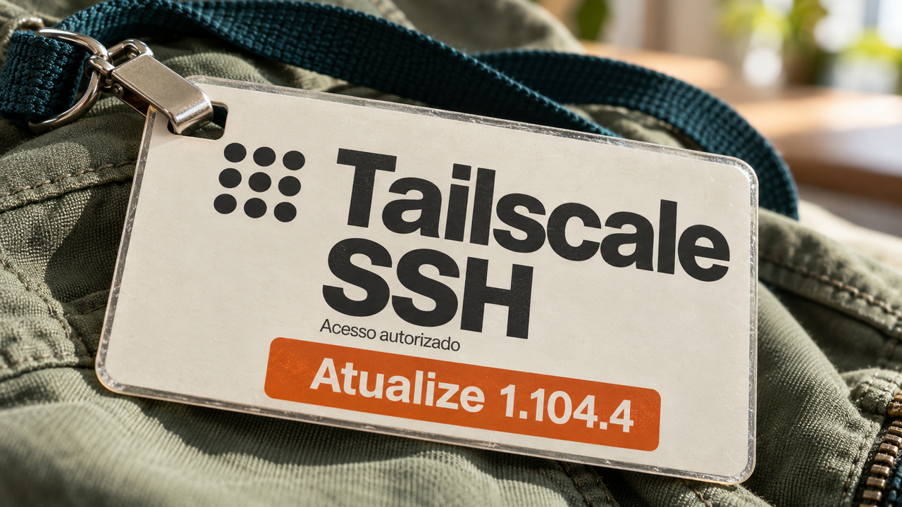

As atualizações do Tailscale e do terminal Ghostty corrigem falhas que afetam o acesso remoto e a interpretação do conteúdo exibido na tela. No KDE, uma mudança prevista para novembro fará a cópia para um pendrive esperar a gravação antes de indicar que terminou. A edição também reúne novidades em ferramentas Python, avaliações de agentes de IA e infraestrutura.

## Tailscale 1.104.4 corrige falhas no servidor SSH integrado

A Tailscale anunciou em **28 de outubro** que a versão **1.104.4** corrige os problemas confirmados na investigação sobre seu servidor SSH integrado. Esse recurso usa identidades e políticas da rede Tailscale para decidir quem pode acessar uma máquina e qual usuário Unix pode assumir. Ele é um servidor distinto do OpenSSH, que também pode ser usado sobre a mesma rede.

O boletim **TS-2026-014** descreve uma quebra nessa separação de permissões. O encaminhamento de sockets Unix — canais de comunicação entre processos locais — fazia operações como **root**, o administrador do sistema. Assim, uma sessão autorizada podia alcançar sockets restritos, como o do Docker. A exploração exige acesso prévio autorizado à rede, permissão de SSH e encaminhamento permitido na política. A correção faz essas operações com os privilégios do usuário autenticado.

Outro boletim trata de consumo de memória sem limite por sessões autenticadas, capaz de derrubar o processo responsável pelas conexões Tailscale. A versão também corrige problemas no Serve, recurso para compartilhar serviços. **A orientação da empresa é atualizar para 1.104.4 ou posterior** e revisar quais usuários e dispositivos realmente precisam de acesso SSH. Para sistemas sensíveis, ela recomenda considerar o modo que exige uma confirmação adicional de autenticação.

Fontes: [anúncio da Tailscale](https://tailscale.com/blog/tailscale-ssh-findings-fixes) e [boletins TS-2026-014 a TS-2026-017](https://tailscale.com/security-bulletins#ts-2026-014).

## Ghostty 1.4 corrige falhas acionadas pela saída exibida no terminal

O **Ghostty 1.4.0**, lançado em **27 de outubro**, corrige falhas no processamento de conteúdo recebido dos programas. Um terminal interpreta comandos de formatação e gráficos junto com o texto que exibe. Segundo os mantenedores, sequências maliciosas do protocolo gráfico Kitty podiam travar o Ghostty, provocar grandes alocações de memória e, em situações limitadas, ler ou apagar arquivos fora dos diretórios temporários permitidos. **Nas versões afetadas, exibir a saída maliciosa já basta para acionar esse grupo de falhas.**

Outras falhas corrigidas exigem interação: colar texto podia contornar a confirmação de comandos em programas sem o mecanismo de proteção chamado *bracketed paste*; no macOS, clicar com Command em certos links preparados podia levar à execução de comandos.

A versão também separa, no macOS, a leitura e a interpretação da saída dos programas em duas threads. Os mantenedores mediram ganho de **25% a 55% na vazão de entrada e saída**, com texto simples e Unicode em um M4 Max, frente à série 1.3. O histórico fora da tela passou a ser comprimido para economizar memória física.

Fonte: [notas do Ghostty 1.4.0, segurança e condições dos testes](https://ghostty.org/docs/install/release-notes/1-4-0).

## KDE prepara cópias que aguardam a gravação no dispositivo removível

Méven Car anunciou em **27 de outubro** a integração de mudanças no **KIO**, biblioteca usada pelo gerenciador de arquivos Dolphin, para corrigir um problema relatado em 2011. A previsão é que elas cheguem no **KDE Frameworks 6.32, em 13 de novembro**; a versão atual ainda mantém o comportamento antigo.

O problema nasce de uma diferença importante: uma chamada de escrita pode terminar quando o sistema recebeu os dados em memória, enquanto o pendrive ainda está gravando. A interface podia mostrar a cópia concluída durante essa espera. Ao mover arquivos, a situação era mais arriscada porque a origem podia ser apagada antes de a cópia estar gravada no destino.

A solução limita a quantidade de dados pendentes conforme a velocidade do destino e, ao final da cópia para um dispositivo removível, espera a sincronização com o armazenamento. Isso aproxima o aviso de conclusão do momento em que os dados foram gravados.

**Na movimentação para um dispositivo removível, os arquivos de origem ficam preservados até a sincronização ter sucesso.** Se ela falhar, permanecem na origem. As mudanças também aproximam o progresso do que foi enviado a sistemas de arquivos de rede. Para o usuário, a espera passa a aparecer dentro da operação, em vez de continuar escondida depois do aviso de conclusão.

Fonte: [explicação do autor, mudanças integradas e calendário do KIO](https://blogs.kde.org/2026/10/27/fixing-kio-copy-to-usb-stick-and-network-filesystems/).

## Destaques rápidos para hoje.

- **uv 0.13 adota um leitor de tar mais rigoroso.** Em anúncio de 27 de outubro, a Astral explica que seu gerenciador de pacotes Python passa a usar o `tar-codec` para interpretar distribuições em código-fonte. A motivação central é evitar que ferramentas diferentes enxerguem arquivos diferentes dentro do mesmo pacote: o índice pode inspecionar um conteúdo e o instalador extrair outro. O novo leitor rejeita combinações ambíguas entre famílias do formato tar. O cuidado com a origem do pacote continua necessário, pois construir uma distribuição de código-fonte pode executar código por definição. Fonte: [projeto e decisões de segurança da Astral](https://astral.sh/blog/tar-codec).

- **Concordat restringe ferramentas de agentes conforme o estado da tarefa.** O trabalho preliminar publicado em 27 de outubro apresenta uma interface que oferece ao modelo apenas as ferramentas permitidas naquela etapa e rejeita chamadas não autorizadas antes de seus efeitos. No teste com tarefas de companhia aérea, o autor relata ausência de alterações sem a confirmação exigida do cliente, inclusive sob pressão simulada para ignorá-la. O resultado vale para o experimento descrito. A proposta é tornar a autorização uma regra do programa que executa o agente, com decisões humanas representadas explicitamente no fluxo. Fonte: [Concordat, método e resultados declarados](https://arxiv.org/abs/2610.37461v1).

- **FeatureArc testa se agentes preservam uma funcionalidade ao ampliá-la.** O trabalho preliminar de 27 de outubro avalia dez agentes em 73 tarefas com duas a dez etapas, trabalhando sobre o próprio código anterior, sem feedback dos testes externos nem retorno automático a versões anteriores. O acerto agregado na primeira etapa foi de **62,7%**; já a correção da funcionalidade completa no código final ficou em **28,5%**. São medidas de exigências diferentes: acertar o começo e entregar o conjunto de requisitos. Os autores identificam erros herdados como uma causa frequente das falhas posteriores. O resultado reforça a utilidade de verificar os requisitos antigos a cada mudança. Fonte: [FeatureArc, condições e resultados do benchmark](https://arxiv.org/abs/2610.37434v1).

- **Liquid AI lança seis modelos LFM3 para especialização e execução local.** A família anunciada em 27 de outubro reúne modelos para texto, visão, áudio e combinações dessas entradas, derivados de uma base comum. O modelo textual tem 1,7 bilhão de parâmetros; a linha fica na faixa de 2 bilhões. A empresa propõe escolher a modalidade necessária e adaptar o modelo com dados próprios. Fonte: [apresentação da Liquid AI no Hugging Face](https://huggingface.co/blog/LiquidAI/lfm3).

- **Project Zero encontra complementaridade entre fuzzing e agentes de IA.** Na comparação publicada em 27 de outubro, o grupo contabiliza **45 vulnerabilidades acionáveis para o BigSleep e 37 para o Fuzzilli** no V8, motor JavaScript do Chrome, entre abril e setembro. O Fuzzilli gera testes para provocar erros; o BigSleep analisa alterações com um modelo de linguagem. A sobreposição observada foi de cerca de 25%, mas um experimento separado com bugs históricos encontrou perto de 60%. A equipe recomenda combinar os métodos e explica que os dados ainda dificultam comparar custo por vulnerabilidade. Fonte: [metodologia e resultados do Project Zero](https://projectzero.google/2026/10/fuzzing-v-AI.html).

- **PortSwigger consegue contornar seis de oito sanitizadores de SVG testados.** Essas bibliotecas tentam remover conteúdo perigoso das imagens vetoriais. A pesquisa de Gareth Heyes, publicada em 27 de outubro, mostra casos em que o navegador ainda interpreta o resultado como conteúdo ativo, incluindo scripts. DOMPurify e `darylldoyle/svg-sanitizer` resistiram aos casos apresentados. Para aplicações que recebem SVG de usuários, o resultado justifica revisar a biblioteca usada e o contexto em que o arquivo é servido e aberto; o comportamento depende também do navegador. Fonte: [pesquisa e escopo dos testes da PortSwigger](https://portswigger.net/research/scalable-vector-grief).

- **OpenTelemetry estabiliza a linguagem OTTL na versão 1.** O anúncio de 27 de outubro estabelece compatibilidade de sintaxe, funções padrão e API Go durante a série 1.x, a partir do Collector Contrib 0.164.0. A linguagem permite transformar e filtrar logs, métricas e rastros de execução antes de enviá-los aos sistemas de observabilidade. Recursos experimentais ficam fora dessa garantia. Quem salta várias versões deve conferir as funções e opções removidas no caminho até a estabilização, para evitar que regras antigas impeçam a atualização. Fonte: [garantias e orientações de migração do OpenTelemetry](https://opentelemetry.io/blog/2026/ottl-v1/).

- **SageMaker passa a iniciar contêineres antes de baixar a imagem inteira.** A AWS anunciou em 27 de outubro suporte a índices SOCI para tarefas de treinamento e processamento. O índice informa onde estão os arquivos necessários, permitindo buscar primeiro o que inicia o contêiner e carregar o restante sob demanda. O recurso exige imagens elegíveis em repositórios privados do Amazon ECR; imagens próprias precisam de seu próprio índice. Nos testes da AWS, parte da espera migrou para a primeira época, a passagem inicial pelos dados de treinamento. O benefício depende de quanto conteúdo a aplicação precisa ler logo no início. Fonte: [funcionamento, medições e restrições do SageMaker](https://aws.amazon.com/blogs/machine-learning/announcing-soci-indexed-images-for-faster-sagemaker-ai-jobs/).

- **NVIDIA leva limites de memória por tarefa ao compartilhamento de GPUs no Kubernetes.** A publicação de 27 de outubro apresenta o GPU Fractioning Operator, que aplica nos nós os limites oferecidos pelo CUDA 13.4. O KAI Scheduler 0.18.0 já consegue escolher a GPU e registrar a alocação para o operador executar. É possível pedir uma quantidade garantida e um máximo maior para usar quando houver memória livre. A escolha do modo de compartilhamento importa: no modo SM-sharing, uma falha pode afetar outras tarefas na mesma GPU, e a NVIDIA recomenda cargas confiáveis para execução conjunta. Fonte: [arquitetura e limites descritos pela NVIDIA](https://developer.nvidia.com/blog/memory-enforced-gpu-sharing-in-kubernetes-with-nvidia-cuda-13-4/).

> Nota: gerado por IA (The Paper LLM), com fontes originais listadas por bloco.

<!--
briefing_id: 29460
source_urls:
  - https://tailscale.com/blog/tailscale-ssh-findings-fixes
  - https://tailscale.com/security-bulletins#ts-2026-014
  - https://ghostty.org/docs/install/release-notes/1-4-0
  - https://blogs.kde.org/2026/10/27/fixing-kio-copy-to-usb-stick-and-network-filesystems/
  - https://astral.sh/blog/tar-codec
  - https://arxiv.org/abs/2610.37461v1
  - https://arxiv.org/abs/2610.37434v1
  - https://huggingface.co/blog/LiquidAI/lfm3
  - https://projectzero.google/2026/10/fuzzing-v-AI.html
  - https://portswigger.net/research/scalable-vector-grief
  - https://opentelemetry.io/blog/2026/ottl-v1/
  - https://aws.amazon.com/blogs/machine-learning/announcing-soci-indexed-images-for-faster-sagemaker-ai-jobs/
  - https://developer.nvidia.com/blog/memory-enforced-gpu-sharing-in-kubernetes-with-nvidia-cuda-13-4/
-->
